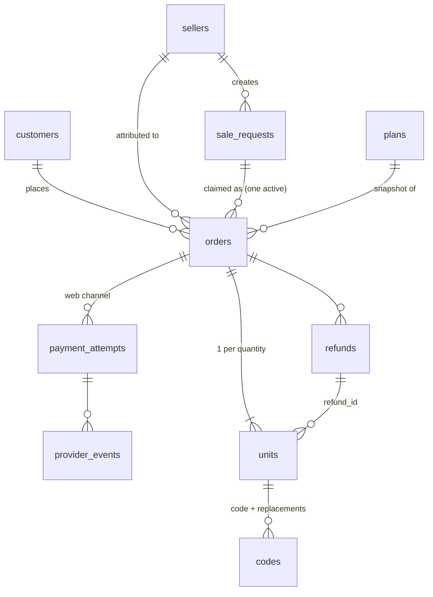

# Nahj Seller Marketplace — Database Design: Subscriptions and Bulk Orders

Status: draft for review, 2026-10-23.
Builds on `system-architecture.md` (§6) and the decisions in `02-system-analysis.md` (§2.3, §3).

This document covers two things:

1. How VIP subscription time is added to, and removed from, a Nahj account (schema `nahj`, owned by `nahj_backend`).
2. How a marketplace order, including a bulk order of many codes, moves through the marketplace tables (schema `nahj_market`).

Other modules (sellers, ledger, referrals, support) are only referenced where these flows touch them.

## 1. Conventions

| Topic | Rule |
| --- | --- |
| Engine | MySQL 8, InnoDB, `utf8mb4_0900_ai_ci` |
| Keys | `BIGINT UNSIGNED AUTO_INCREMENT` primary keys inside the database. Values shown to people (order reference, code) are separate unique columns. |
| Money | `BIGINT`, whole rupiah. No decimals, no floats. |
| Time | `DATETIME(3)`, always UTC. |
| Status | Short `VARCHAR` values checked in code, not MySQL `ENUM`s, so adding a status is not a table rebuild. |
| Optimistic locking | `version INT NOT NULL DEFAULT 1` on rows that people edit. |
| "Only one active" rules | A nullable flag column (`1` or `NULL`) inside a unique key. MySQL allows many `NULL`s in a unique key but only one `1`. |
| Who owns what | `nahj_market` tables are written only by the marketplace. `nahj` tables are written only by `nahj_backend`. The marketplace never connects to `nahj`. |

## 2. Adding subscription time (`nahj_backend`, schema `nahj`)

### 2.1 Idea

Every source of VIP time is **one row in the existing `orders` table**: a store purchase, a marketplace unit, or an admin gift. Each row records the exact VIP period it covers (`start_time` to `end_time`). The user's expiry date is simply the latest `end_time` of their active VIP orders. `user_subscription` and `users.user_type` are kept up to date as a copy, so the current apps keep working.

### 2.2 Changes to `orders`

```sql
ALTER TABLE orders
  ADD COLUMN source           VARCHAR(16)  NOT NULL DEFAULT 'store',  -- store | marketplace | admin
  ADD COLUMN source_ref       VARCHAR(64)  NULL,                      -- e.g. marketplace unit ID
  ADD COLUMN item_category    VARCHAR(32)  NOT NULL DEFAULT '',       -- vip_pass, gems, ...
  ADD COLUMN duration_days    INT          NULL,                      -- copied from the item at completion
  ADD COLUMN is_lifetime      TINYINT(1)   NOT NULL DEFAULT 0,
  ADD COLUMN refunded_at      DATETIME(3)  NULL,
  ADD COLUMN refunded_days    INT          NULL,                      -- whole days removed (see 2.5)
  ADD COLUMN refunded_seconds BIGINT       NULL,                      -- exact time removed
  ADD KEY idx_user_vip (user_id, item_category, status, end_time);
-- client_order_id is already UNIQUE: it is the idempotency key.
```

Fixes to existing code that writes `orders`:

- `start_time` and `end_time` must hold the real VIP period. Today both are set to the insert time.
- `amount` must hold the price. Today it is 0, and the price is written into `currency`.

### 2.3 Adding time: one transaction

The same function serves store purchases, marketplace units and admin gifts.

```sql
START TRANSACTION;

-- 1. Serialize all VIP changes for this user.
SELECT id FROM users WHERE id = :user_id FOR UPDATE;

-- 2. Idempotency: the same source never adds time twice.
SELECT * FROM orders WHERE client_order_id = :client_order_id;
--    If it exists and is COMPLETED, return its result unchanged and stop.

-- 3. Current end of VIP time.
SELECT MAX(end_time) AS current_end
FROM orders
WHERE user_id = :user_id
  AND item_category = 'vip_pass'
  AND status = 'COMPLETED'
  AND end_time > UTC_TIMESTAMP(3);

-- 4. New period: start at the end of current time, or now.
--    start = GREATEST(now, IFNULL(current_end, now))
--    end   = start + duration_days * 24 hours
INSERT INTO orders (client_order_id, user_id, item_id, item_category, source, source_ref,
                    duration_days, is_lifetime, amount, currency, status, start_time, end_time, ...)
VALUES (...);

-- 5. Compatibility copy for the current apps.
--    One active VIP row in user_subscription with expired_at = new end;
--    users.user_type = 3 (VIP).

COMMIT;
```

Example (Monthly = 30 days):

| Event | Order row | `start_time` | `end_time` | User expiry |
| --- | --- | --- | --- | --- |
| Jan 1, buys Monthly in the store | `store-GPA.123` | Jan 1 | Jan 31 | Jan 31 |
| Jan 10, redeems a marketplace code | `mk-unit-5012` | Jan 31 | Mar 2 | Mar 2 |
| Jan 20, buys Lifetime on the web | `mk-unit-5101` | Mar 2 | Mar 2, 2126 | Mar 2, 2126 · Lifetime |

Rules that come from this:

- **Unused codes:** nothing is written to `nahj` until a code is redeemed, so a code's days start at redemption.
- **Lifetime holder:** a user has an active order with `is_lifetime = 1`, status `COMPLETED`, and `end_time > now`. The marketplace asks this before a direct activation or redeem and refuses if true.
- **Concurrency:** the `users` row lock in step 1 means two purchases for the same user can never read the same `current_end`.

### 2.4 Reading access

```sql
SELECT MAX(end_time) AS expires_at, MAX(is_lifetime) AS lifetime
FROM orders
WHERE user_id = :user_id AND item_category = 'vip_pass'
  AND status = 'COMPLETED' AND end_time > UTC_TIMESTAMP(3);
```

The access projection endpoint returns this, plus a projection version. The expiry job reads it too, instead of trusting `user_subscription`.

### 2.5 Removing time on refund or chargeback

Only the order's **unused** time is removed, and later orders move earlier by that amount (decision of 2026-10-20).

```sql
START TRANSACTION;
SELECT id FROM users WHERE id = :user_id FOR UPDATE;
SELECT * FROM orders WHERE client_order_id = :client_order_id FOR UPDATE;
--   If already REFUNDED, return the stored result (idempotent).

-- unused = end_time - GREATEST(start_time, now)   (0 if the order has ended)
-- Case A: the order has not started yet (queued) → all of it is unused.
-- Case B: the order is running → it now ends at now.
-- Case C: the order has ended → unused = 0, nothing moves.

UPDATE orders
SET status = 'REFUNDED', refunded_at = now,
    refunded_seconds = :unused, refunded_days = CEIL(:unused / 86400),
    end_time = end_time - INTERVAL :unused SECOND
WHERE id = :order_id;

-- Every VIP order queued after it moves earlier by the same amount.
UPDATE orders
SET start_time = start_time - INTERVAL :unused SECOND,
    end_time   = end_time   - INTERVAL :unused SECOND
WHERE user_id = :user_id AND item_category = 'vip_pass' AND status = 'COMPLETED'
  AND start_time >= :refunded_order_original_end;

-- Recompute the compatibility copy (user_subscription, user_type).
COMMIT;
```

Example, continuing 2.3. The store Monthly is refunded on Jan 15:

| Order | Before | After |
| --- | --- | --- |
| `store-GPA.123` | Jan 1 – Jan 31 | REFUNDED, Jan 1 – Jan 15 (16 days removed) |
| `mk-unit-5012` | Jan 31 – Mar 2 | Jan 15 – Feb 14 |
| `mk-unit-5101` (Lifetime) | Mar 2 – Mar 2, 2126 | Feb 14 – Feb 14, 2126 |

### 2.6 Internal endpoints that use this

| Endpoint | Function |
| --- | --- |
| `POST /internal/v1/vip/grants` | 2.3, with `client_order_id = "mk-unit-{unit_id}"` |
| `POST /internal/v1/vip/grants/{client_order_id}/refund` | 2.5 |
| `GET /internal/v1/vip/{user_id}` | 2.4 and the Lifetime-holder flag |
| `GET /internal/v1/vip/{user_id}/orders` | List of VIP orders for history and Support |

## 3. Marketplace tables for orders (schema `nahj_market`)

The full schema is **31 tables**; `database-tables.html` lists every table and column and is the source of truth. It was optimized on 2026-10-25 from a first draft of 73 tables. This section shows the tables these flows use.

### 3.1 Overview



Main ideas:

- **One `orders` table for both channels.** A web order comes from a sale link and is paid by QRIS or VA. A store order (`channel = store`) is an in-app purchase credited by an agent code; it is already paid and always has one unit.
- **`units` carries everything per unit:** price, commission and its release state, the VIP grant in `nahj_backend` (`grant_client_order_id`, `vip_start`, `vip_end`), refund deadline and refund link.
- **`codes` carries the activation code**, its replacement chain and who redeemed it.

### 3.2 Draft SQL

Generated from `database-tables.html`.

```sql
-- plans
CREATE TABLE plans (
  id BIGINT UNSIGNED NOT NULL AUTO_INCREMENT,
  plan_code VARCHAR(32) NOT NULL,
  version INT NOT NULL,
  status VARCHAR(12) NOT NULL,
  effective_from DATETIME(3) NULL,
  item_id VARCHAR(64) NOT NULL,
  duration_days INT NOT NULL,
  is_lifetime TINYINT(1) NOT NULL DEFAULT 0,
  unit_price BIGINT NOT NULL,
  commission_bps INT NOT NULL,
  store_base_price BIGINT NOT NULL,
  store_commission_bps INT NOT NULL,
  refund_window_hours INT NOT NULL DEFAULT 48,
  unused_refund_days INT NOT NULL DEFAULT 30,
  max_quantity INT NOT NULL,
  web_enabled TINYINT(1) NOT NULL DEFAULT 1,
  display_order INT NOT NULL DEFAULT 0,
  created_by BIGINT UNSIGNED NOT NULL,
  approval_id BIGINT UNSIGNED NULL,
  created_at DATETIME(3) NOT NULL,
  PRIMARY KEY (id),
  UNIQUE KEY (plan_code, version)
) ENGINE=InnoDB DEFAULT CHARSET=utf8mb4 COLLATE=utf8mb4_0900_ai_ci;

-- customers
CREATE TABLE customers (
  account_id VARCHAR(64) NOT NULL,
  display_name VARCHAR(128) NULL,
  email_masked VARCHAR(128) NULL,
  status VARCHAR(12) NOT NULL DEFAULT 'active',
  risk_flag VARCHAR(32) NULL,
  first_order_at DATETIME(3) NULL,
  last_order_at DATETIME(3) NULL,
  created_at DATETIME(3) NOT NULL,
  anonymized_at DATETIME(3) NULL,
  PRIMARY KEY (account_id)
) ENGINE=InnoDB DEFAULT CHARSET=utf8mb4 COLLATE=utf8mb4_0900_ai_ci;

-- sale_requests
CREATE TABLE sale_requests (
  id BIGINT UNSIGNED NOT NULL AUTO_INCREMENT,
  token CHAR(32) NOT NULL UNIQUE,
  seller_id BIGINT UNSIGNED NOT NULL,
  plan_code VARCHAR(32) NOT NULL,
  quantity INT NOT NULL,
  fulfillment_mode VARCHAR(8) NOT NULL,
  status VARCHAR(12) NOT NULL,
  expires_at DATETIME(3) NOT NULL,
  quote_plan_id BIGINT UNSIGNED NULL,
  quote_unit_price BIGINT NULL,
  quote_total BIGINT NULL,
  quote_commission_bps INT NULL,
  quote_expires_at DATETIME(3) NULL,
  quote_version INT NOT NULL DEFAULT 0,
  claimed_by_account_id VARCHAR(64) NULL,
  claimed_at DATETIME(3) NULL,
  version INT NOT NULL DEFAULT 1,
  created_at DATETIME(3) NOT NULL,
  PRIMARY KEY (id)
) ENGINE=InnoDB DEFAULT CHARSET=utf8mb4 COLLATE=utf8mb4_0900_ai_ci;

-- orders
CREATE TABLE orders (
  id BIGINT UNSIGNED NOT NULL AUTO_INCREMENT,
  reference VARCHAR(20) NOT NULL UNIQUE,
  channel VARCHAR(6) NOT NULL,
  buyer_account_id VARCHAR(64) NOT NULL,
  seller_id BIGINT UNSIGNED NOT NULL,
  sale_request_id BIGINT UNSIGNED NULL,
  active_flag TINYINT NULL,
  replaces_order_id BIGINT UNSIGNED NULL,
  plan_id BIGINT UNSIGNED NOT NULL,
  item_id VARCHAR(64) NOT NULL,
  duration_days INT NOT NULL,
  is_lifetime TINYINT(1) NOT NULL,
  quantity INT NOT NULL,
  unit_price BIGINT NOT NULL,
  total BIGINT NOT NULL,
  currency CHAR(3) NOT NULL DEFAULT 'IDR',
  commission_bps INT NOT NULL,
  referral_bps INT NULL,
  referrer_seller_id BIGINT UNSIGNED NULL,
  refund_window_hours INT NOT NULL,
  unused_refund_days INT NOT NULL,
  accepted_policies JSON NULL,
  fulfillment_mode VARCHAR(8) NOT NULL,
  payment_status VARCHAR(16) NOT NULL,
  fulfillment_status VARCHAR(16) NOT NULL,
  refund_status VARCHAR(16) NOT NULL DEFAULT 'none',
  winning_attempt_id BIGINT UNSIGNED NULL UNIQUE,
  payment_confirmed_at DATETIME(3) NULL,
  settled_at DATETIME(3) NULL,
  store VARCHAR(8) NULL,
  store_transaction_id VARCHAR(128) NULL,
  original_transaction_id VARCHAR(128) NULL,
  nahj_order_id VARCHAR(64) NULL,
  agent_code VARCHAR(16) NULL,
  reported_price BIGINT NULL,
  reported_currency CHAR(3) NULL,
  earns TINYINT(1) NOT NULL DEFAULT 1,
  store_hold_hours INT NULL,
  version INT NOT NULL DEFAULT 1,
  created_at DATETIME(3) NOT NULL,
  PRIMARY KEY (id),
  UNIQUE KEY (sale_request_id, active_flag),
  UNIQUE KEY (store, store_transaction_id),
  CHECK (fulfillment_mode = 'codes' OR quantity = 1),
  KEY (buyer_account_id, created_at),
  KEY (seller_id, created_at)
) ENGINE=InnoDB DEFAULT CHARSET=utf8mb4 COLLATE=utf8mb4_0900_ai_ci;

-- payment_attempts
CREATE TABLE payment_attempts (
  id BIGINT UNSIGNED NOT NULL AUTO_INCREMENT,
  order_id BIGINT UNSIGNED NOT NULL,
  provider VARCHAR(16) NOT NULL,
  method VARCHAR(24) NOT NULL,
  route_version INT NOT NULL,
  merchant_id VARCHAR(64) NOT NULL,
  expected_amount BIGINT NOT NULL,
  received_amount BIGINT NULL,
  currency CHAR(3) NOT NULL,
  provider_reference VARCHAR(128) NULL,
  provider_transaction_id VARCHAR(128) NULL,
  status VARCHAR(12) NOT NULL,
  instructions JSON NULL,
  expires_at DATETIME(3) NULL,
  succeeded_at DATETIME(3) NULL,
  settled_at DATETIME(3) NULL,
  created_at DATETIME(3) NOT NULL,
  PRIMARY KEY (id),
  UNIQUE KEY (provider, provider_transaction_id),
  KEY (order_id)
) ENGINE=InnoDB DEFAULT CHARSET=utf8mb4 COLLATE=utf8mb4_0900_ai_ci;

-- provider_events
CREATE TABLE provider_events (
  id BIGINT UNSIGNED NOT NULL AUTO_INCREMENT,
  provider VARCHAR(16) NOT NULL,
  kind VARCHAR(8) NOT NULL,
  event_id VARCHAR(128) NOT NULL,
  attempt_id BIGINT UNSIGNED NULL,
  payload JSON NOT NULL,
  received_at DATETIME(3) NOT NULL,
  processed_at DATETIME(3) NULL,
  result VARCHAR(16) NULL,
  PRIMARY KEY (id),
  UNIQUE KEY (provider, event_id)
) ENGINE=InnoDB DEFAULT CHARSET=utf8mb4 COLLATE=utf8mb4_0900_ai_ci;

-- units
CREATE TABLE units (
  id BIGINT UNSIGNED NOT NULL AUTO_INCREMENT,
  order_id BIGINT UNSIGNED NOT NULL,
  unit_index INT NOT NULL,
  unit_price BIGINT NOT NULL,
  commission_amount BIGINT NOT NULL,
  referral_amount BIGINT NOT NULL DEFAULT 0,
  reversible_amount BIGINT NOT NULL,
  status VARCHAR(20) NOT NULL,
  activated_account_id VARCHAR(64) NULL,
  activated_at DATETIME(3) NULL,
  refund_deadline_at DATETIME(3) NOT NULL,
  grant_client_order_id VARCHAR(64) NULL UNIQUE,
  grant_status VARCHAR(16) NULL,
  vip_start DATETIME(3) NULL,
  vip_end DATETIME(3) NULL,
  commission_status VARCHAR(12) NOT NULL,
  commission_release_at DATETIME(3) NULL,
  refund_id BIGINT UNSIGNED NULL,
  version INT NOT NULL DEFAULT 1,
  PRIMARY KEY (id),
  UNIQUE KEY (order_id, unit_index),
  KEY (order_id, status),
  KEY (commission_status, commission_release_at)
) ENGINE=InnoDB DEFAULT CHARSET=utf8mb4 COLLATE=utf8mb4_0900_ai_ci;

-- codes
CREATE TABLE codes (
  id BIGINT UNSIGNED NOT NULL AUTO_INCREMENT,
  unit_id BIGINT UNSIGNED NOT NULL,
  code_hash BINARY(32) NOT NULL UNIQUE,
  code_encrypted VARBINARY(256) NOT NULL,
  code_last4 CHAR(4) NOT NULL,
  status VARCHAR(12) NOT NULL,
  live_flag TINYINT NULL,
  replaces_code_id BIGINT UNSIGNED NULL,
  published_at DATETIME(3) NULL,
  redeemed_account_id VARCHAR(64) NULL,
  redeemed_at DATETIME(3) NULL,
  redeem_operation_key VARCHAR(64) NULL UNIQUE,
  created_at DATETIME(3) NOT NULL,
  PRIMARY KEY (id),
  UNIQUE KEY (unit_id, live_flag)
) ENGINE=InnoDB DEFAULT CHARSET=utf8mb4 COLLATE=utf8mb4_0900_ai_ci;

-- refunds
CREATE TABLE refunds (
  id BIGINT UNSIGNED NOT NULL AUTO_INCREMENT,
  order_id BIGINT UNSIGNED NOT NULL,
  attempt_id BIGINT UNSIGNED NULL,
  kind VARCHAR(12) NOT NULL,
  amount BIGINT NOT NULL,
  reason VARCHAR(255) NOT NULL,
  status VARCHAR(16) NOT NULL,
  method VARCHAR(12) NULL,
  provider_command VARCHAR(128) NULL,
  provider_case_id VARCHAR(128) NULL,
  deadline_at DATETIME(3) NULL,
  payout_destination JSON NULL,
  payout_provider VARCHAR(16) NULL,
  payout_key VARCHAR(64) NULL UNIQUE,
  payout_ref VARCHAR(128) NULL,
  requested_by VARCHAR(80) NOT NULL,
  approved_by BIGINT UNSIGNED NULL,
  version INT NOT NULL DEFAULT 1,
  created_at DATETIME(3) NOT NULL,
  PRIMARY KEY (id)
) ENGINE=InnoDB DEFAULT CHARSET=utf8mb4 COLLATE=utf8mb4_0900_ai_ci;

-- sellers
CREATE TABLE sellers (
  id BIGINT UNSIGNED NOT NULL AUTO_INCREMENT,
  account_id VARCHAR(64) NOT NULL UNIQUE,
  agent_type VARCHAR(12) NOT NULL DEFAULT 'partner',
  application_status VARCHAR(16) NOT NULL,
  operating_status VARCHAR(12) NOT NULL,
  display_name VARCHAR(80) NOT NULL,
  display_name_norm VARCHAR(80) NOT NULL UNIQUE,
  city VARCHAR(64) NOT NULL,
  bio VARCHAR(500) NULL,
  logo_file_id BIGINT UNSIGNED NULL,
  contact JSON NULL,
  phone_masked VARCHAR(32) NULL,
  listed_in_directory TINYINT(1) NOT NULL DEFAULT 1,
  referrer_seller_id BIGINT UNSIGNED NULL,
  agent_code VARCHAR(16) NULL UNIQUE,
  agent_alias VARCHAR(16) NULL UNIQUE,
  commission_bps INT NULL,
  store_commission_bps INT NULL,
  store_hold_hours_google INT NULL,
  store_hold_hours_apple INT NULL,
  mfa_verified_at DATETIME(3) NULL,
  terms_policy_id BIGINT UNSIGNED NULL,
  terms_accepted_at DATETIME(3) NULL,
  onboarded_at DATETIME(3) NULL,
  reviewer_staff_id BIGINT UNSIGNED NULL,
  decided_at DATETIME(3) NULL,
  decision_reason VARCHAR(255) NULL,
  created_at DATETIME(3) NOT NULL,
  version INT NOT NULL DEFAULT 1,
  PRIMARY KEY (id),
  KEY (operating_status, listed_in_directory, city)
) ENGINE=InnoDB DEFAULT CHARSET=utf8mb4 COLLATE=utf8mb4_0900_ai_ci;
```

The bulk design in one sentence: **an order of 10 codes is one `orders` row, 10 `units` rows and 10 `codes` rows, and every unit carries its own price, commission, status, refund deadline and grant.** That is what makes "4 used, refund the other 6" work.

## 4. Flows

### 4.1 Direct activation, quantity 1

| Step | What happens | Rows |
| --- | --- | --- |
| 1 | The seller creates a request for Monthly × 1, direct | `sale_requests` (awaiting) |
| 2 | The buyer opens the link, signs in, sees a quote | `customers` (if new), the quote columns on `sale_requests` |
| 3 | The buyer confirms | One transaction: `sale_requests` → claimed; `orders` (unpaid, snapshot); outbox: none |
| 4 | The buyer picks QRIS | `payment_attempts` (pending) through the route; QR returned |
| 5 | The provider webhook says paid | One transaction (§10.1 of the architecture): `provider_events`; order → paid, `payment_confirmed_at`; **1** `units` row (awaiting_fulfillment); ledger `payment_accepted`, `commission_accrued`; **instant fulfillment:** the grant columns on `units` (requested), outbox: create-grant call with `rejectIfLifetime`; outbox: notifications |
| 6 | (no seller step) | Fulfillment is instant at payment (decision 17). |
| 7 | The worker calls `nahj_backend` | `nahj.orders` row `mk-unit-{id}` with its VIP period (§2.3) |
| 8 | Grant confirmed | the grant columns on `units` → granted, VIP dates stored; unit → activated, `activated_at`, `refund_deadline_at = activated_at + 48 h`; order → completed; outbox: "subscription activated" notification |

### 4.2 Bulk order: 10 Yearly codes

| Step | What happens | Rows |
| --- | --- | --- |
| 1–4 | As above, with Yearly × 10, codes | `sale_requests`, the quote columns on `sale_requests`, `orders` (quantity 10), `payment_attempts` |
| 5 | Payment accepted | Same transaction: **10** `units` (index 1..10, status issued); **10** `codes` (live, `published_at = now`); `refund_deadline_at = payment_confirmed_at + 30 days` on each; ledger `commission_accrued` × 10; `codes.published_at` (portal, actor `system`); outbox: email linking to "My Purchases"; order fulfillment → completed |
| 6 | (no seller step) | Codes are visible to the buyer immediately (decision 17). |
| 7 | The buyer sees 10 codes in "My Purchases" and gives them to children | Reveals are audited; no rows about who received them |
| 8 | A child redeems code #3 on their own account | One transaction: credential locked → consumed; `codes` (redeemed columns); unit #3 → redeemed, `activated_account_id`; the grant columns on `units` (requested); outbox: create-grant |
| 9 | Grant confirmed | Unit #3 → activated, `activated_at`; `refund_deadline_at = activated_at + 48 h`; commission on unit #3 can now be released once 168 h have passed |

The order's fulfillment status is "completed" at payment, when every code is published; it does not wait for redemptions (confirmed 2026-10-23).

### 4.3 Bulk refund: 4 codes used, refund the other 6

| Step | What happens | Rows |
| --- | --- | --- |
| 1 | The buyer asks for a refund within 30 days of payment | `refunds` (requested); support case. Nothing is reserved yet. |
| 2 | Finance reviews | The screen shows only unused units (status `issued`) with `refund_deadline_at > now`: here units 1, 2, 4, 5, 6, 7 |
| 3 | Finance approves the six | One transaction: those six units locked and re-checked (still unused?), → reserved; credentials → voided (they can no longer be redeemed); `units.refund_id` × 6 with each unit's original price and commission; ledger `refund_approved`; outbox: provider refund, or a payout if the method cannot refund (VA) |
| 4 | Provider confirms | Units → refunded; `reversible_amount` reduced; ledger `refund_completed`, `commission_reversed` × 6; order `refund_status = partial`; referral month requalified |
| 5 | Provider fails definitively | Finance retries, or rolls back: units return to their previous status and the credentials are restored, with an audit record |

Units 3, 8, 9 and 10 (redeemed) are untouched. If a redeemed unit is still inside its own 48-hour window, Finance may include it. In that case step 4 also calls the refund endpoint in `nahj_backend` for that unit's grant (§2.5).

### 4.4 Refund deadline per unit

| Unit state | `refund_deadline_at` |
| --- | --- |
| Code not yet redeemed | `payment_confirmed_at + unused_refund_days` (30 days) |
| Activated (direct or redeemed) | `activated_at + refund_window_hours` (48 h) |

Both values come from the order snapshot, not from current settings.

### 4.5 Commission release per unit

| Unit | `commission_release_at` |
| --- | --- |
| Direct activation | `settled_at + 168 h` |
| Code | `GREATEST(settled_at + 168 h, LEAST(activated_at, payment_confirmed_at + unused_refund_days))`. Computed when the unit is redeemed, or by the maturity job when the 30 days end. |

The commission maturity job releases each unit's commission individually with a `commission_matured` journal whose source is the unit, so each unit is released once.

## 5. Open points for review

1. Order reference format `NHO-YYMMDD-XXXX` and code format `NHJ-XXXX-XXXX-XXXX`.
2. ~~When is an order completed?~~ Decided: at payment; fulfillment is instant (decision 17).
3. ~~Who changes `nahj_backend`?~~ Decided: a separate session, using `docs/prompts/01-nahj-backend-vip-orders.md`.

## 6. App-store sales through agent codes (flow B)

See `system-architecture.md` §6.9 for the flow and rules.

### 6.1 Marketplace side (`nahj_market`)

No extra tables. Flow B uses:

- **`sellers`:**
  - `agent_type` (partner, employee), with `store_commission_bps = 0` for employees;
  - `agent_code` (unique) and `agent_alias` (unique, after approval through `seller_revisions`);
  - `store_hold_hours_google` and `store_hold_hours_apple` (wallet overrides);
  - `listed_in_directory`.
- **`plans`:** `store_base_price` (IDR) and `store_commission_bps` per VIP item.
- **`settings`:** `store_hold_hours` (google 72, apple 336), `earning_currencies` (`["IDR"]`).
- **`orders` with `channel = store`:**
  - `store`, `store_transaction_id` (unique together), `original_transaction_id`, `nahj_order_id`;
  - `agent_code`, `reported_price`, `reported_currency`, `earns`, `store_hold_hours`;
  - payment status `paid` and fulfillment `completed` when recorded.
- **`units`:** one unit per store order. Its commission is `store_base_price × rate`, and `commission_release_at = purchase time + store_hold_hours`.

When the store does not report a currency (possible on Google), the sale counts as earning; the currency rule applies only when a currency is known.

### 6.2 Ledger

| Journal | Debit | Credit | Source |
| --- | --- | --- | --- |
| `store_commission_accrued` | commission_expense | seller pending | unit of the store order |
| `store_commission_matured` | seller pending | seller available | unit, at `commission_release_at` |
| `store_commission_reversed` | seller pending or available | commission_expense | refund (kind store) |

Store revenue itself is not in the marketplace ledger. Google and Apple pay Nahj directly, and Finance books that from the store reports. Zero-amount journals are skipped.

### 6.3 Changes in `nahj_backend` (schema `nahj`)

```sql
ALTER TABLE orders ADD COLUMN agent_code VARCHAR(16) NULL;   -- copied at completion

-- users_attributes keys (existing key/value table):
--   agent_code        = AGT-7K2M3P
--   agent_code_set_at = 2026-10-25T08:00:00Z

CREATE TABLE marketplace_outbox (
  id            BIGINT UNSIGNED AUTO_INCREMENT PRIMARY KEY,
  event_type    VARCHAR(24)  NOT NULL,       -- store_sale, store_refund
  event_key     VARCHAR(160) NOT NULL UNIQUE, -- e.g. store_sale:google:GPA.1234
  payload       JSON         NOT NULL,
  attempts      INT          NOT NULL DEFAULT 0,
  next_try_at   DATETIME(3)  NOT NULL,
  sent_at       DATETIME(3)  NULL,
  last_error    VARCHAR(255) NULL,
  created_at    DATETIME(3)  NOT NULL
);
```

The outbox row is written in the **same transaction** as the order completion or refund, so an event can never be lost or sent for a purchase that did not happen.

### 6.4 Example

| Step | Row |
| --- | --- |
| Agent shares `AGT-7K2M3P` | `sellers.agent_code` |
| User enters it | `users_attributes.agent_code = AGT-7K2M3P` |
| User buys Monthly in Google Play for Rp75,000 | `nahj.orders` row with `agent_code`, VIP period; `marketplace_outbox` store_sale |
| Event arrives | `orders` (channel store) + 1 `units` row: base price Rp75,000 (from the catalog), store rate 10%, commission Rp7,500, release in 72 h; journal `store_commission_accrued` |
| 72 hours later, no refund | `store_commission_matured` → Available |
| (If refunded inside 48 h) | `nahj` removes unused days; store_refund event; `store_commission_reversed`; the sale is marked refunded |

