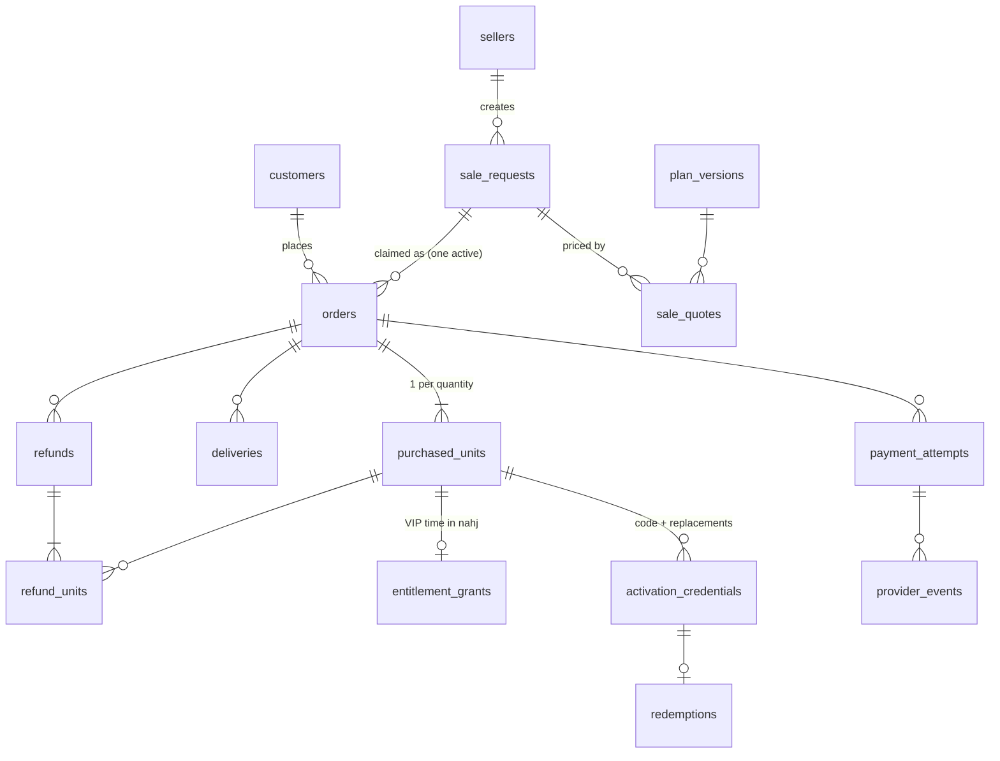

# Nahj Seller Marketplace — Database Design: Subscriptions and Bulk Orders

Status: draft for review, 2026-10-23.
Builds on `system-architecture.md` (§6) and the decisions in `02-system-analysis.md` (§2.3, §3).

This document covers two things:

1. How VIP subscription time is added to, and removed from, a Nahj account (schema `nahj`, owned by `nahj_backend`).
2. How a marketplace order, including a bulk order of many codes, moves through the marketplace tables (schema `nahj_market`).

Other modules (sellers, ledger, referrals, support) are only referenced where these flows touch them.

## 1. Conventions

| Topic | Rule |
| --- | --- |
| Engine | MySQL 8, InnoDB, `utf8mb4_0900_ai_ci` |
| Keys | `BIGINT UNSIGNED AUTO_INCREMENT` primary keys inside the database. Values shown to people (order reference, code) are separate unique columns. |
| Money | `BIGINT`, whole rupiah. No decimals, no floats. |
| Time | `DATETIME(3)`, always UTC. |
| Status | Short `VARCHAR` values checked in code, not MySQL `ENUM`s, so adding a status is not a table rebuild. |
| Optimistic locking | `version INT NOT NULL DEFAULT 1` on rows that people edit. |
| "Only one active" rules | A nullable flag column (`1` or `NULL`) inside a unique key. MySQL allows many `NULL`s in a unique key but only one `1`. |
| Who owns what | `nahj_market` tables are written only by the marketplace. `nahj` tables are written only by `nahj_backend`. The marketplace never connects to `nahj`. |

## 2. Adding subscription time (`nahj_backend`, schema `nahj`)

### 2.1 Idea

Every source of VIP time is **one row in the existing `orders` table**: a store purchase, a marketplace unit, or an admin gift. Each row records the exact VIP period it covers (`start_time` to `end_time`). The user's expiry date is simply the latest `end_time` of their active VIP orders. `user_subscription` and `users.user_type` are kept up to date as a copy, so the current apps keep working.

### 2.2 Changes to `orders`

```sql
ALTER TABLE orders
  ADD COLUMN source           VARCHAR(16)  NOT NULL DEFAULT 'store',  -- store | marketplace | admin
  ADD COLUMN source_ref       VARCHAR(64)  NULL,                      -- e.g. marketplace unit ID
  ADD COLUMN item_category    VARCHAR(32)  NOT NULL DEFAULT '',       -- vip_pass, gems, ...
  ADD COLUMN duration_days    INT          NULL,                      -- copied from the item at completion
  ADD COLUMN is_lifetime      TINYINT(1)   NOT NULL DEFAULT 0,
  ADD COLUMN refunded_at      DATETIME(3)  NULL,
  ADD COLUMN refunded_days    INT          NULL,                      -- whole days removed (see 2.5)
  ADD COLUMN refunded_seconds BIGINT       NULL,                      -- exact time removed
  ADD KEY idx_user_vip (user_id, item_category, status, end_time);
-- client_order_id is already UNIQUE: it is the idempotency key.
```

Fixes to existing code that writes `orders`:

- `start_time` and `end_time` must hold the real VIP period. Today both are set to the insert time.
- `amount` must hold the price. Today it is 0, and the price is written into `currency`.

### 2.3 Adding time: one transaction

The same function serves store purchases, marketplace units and admin gifts.

```sql
START TRANSACTION;

-- 1. Serialize all VIP changes for this user.
SELECT id FROM users WHERE id = :user_id FOR UPDATE;

-- 2. Idempotency: the same source never adds time twice.
SELECT * FROM orders WHERE client_order_id = :client_order_id;
--    If it exists and is COMPLETED, return its result unchanged and stop.

-- 3. Current end of VIP time.
SELECT MAX(end_time) AS current_end
FROM orders
WHERE user_id = :user_id
  AND item_category = 'vip_pass'
  AND status = 'COMPLETED'
  AND end_time > UTC_TIMESTAMP(3);

-- 4. New period: start at the end of current time, or now.
--    start = GREATEST(now, IFNULL(current_end, now))
--    end   = start + duration_days * 24 hours
INSERT INTO orders (client_order_id, user_id, item_id, item_category, source, source_ref,
                    duration_days, is_lifetime, amount, currency, status, start_time, end_time, ...)
VALUES (...);

-- 5. Compatibility copy for the current apps.
--    One active VIP row in user_subscription with expired_at = new end;
--    users.user_type = 3 (VIP).

COMMIT;
```

Example (Monthly = 30 days):

| Event | Order row | `start_time` | `end_time` | User expiry |
| --- | --- | --- | --- | --- |
| Jan 1, buys Monthly in the store | `store-GPA.123` | Jan 1 | Jan 31 | Jan 31 |
| Jan 10, redeems a marketplace code | `mk-unit-5012` | Jan 31 | Mar 2 | Mar 2 |
| Jan 20, buys Lifetime on the web | `mk-unit-5101` | Mar 2 | Mar 2, 2126 | Mar 2, 2126 · Lifetime |

Rules that come from this:

- **Unused codes:** nothing is written to `nahj` until a code is redeemed, so a code's days start at redemption.
- **Lifetime holder:** a user has an active order with `is_lifetime = 1`, status `COMPLETED`, and `end_time > now`. The marketplace asks this before a direct activation or redeem and refuses if true.
- **Concurrency:** the `users` row lock in step 1 means two purchases for the same user can never read the same `current_end`.

### 2.4 Reading access

```sql
SELECT MAX(end_time) AS expires_at, MAX(is_lifetime) AS lifetime
FROM orders
WHERE user_id = :user_id AND item_category = 'vip_pass'
  AND status = 'COMPLETED' AND end_time > UTC_TIMESTAMP(3);
```

The access projection endpoint returns this, plus a projection version. The expiry job reads it too, instead of trusting `user_subscription`.

### 2.5 Removing time on refund or chargeback

Only the order's **unused** time is removed, and later orders move earlier by that amount (decision of 2026-10-20).

```sql
START TRANSACTION;
SELECT id FROM users WHERE id = :user_id FOR UPDATE;
SELECT * FROM orders WHERE client_order_id = :client_order_id FOR UPDATE;
--   If already REFUNDED, return the stored result (idempotent).

-- unused = end_time - GREATEST(start_time, now)   (0 if the order has ended)
-- Case A: the order has not started yet (queued) → all of it is unused.
-- Case B: the order is running → it now ends at now.
-- Case C: the order has ended → unused = 0, nothing moves.

UPDATE orders
SET status = 'REFUNDED', refunded_at = now,
    refunded_seconds = :unused, refunded_days = CEIL(:unused / 86400),
    end_time = end_time - INTERVAL :unused SECOND
WHERE id = :order_id;

-- Every VIP order queued after it moves earlier by the same amount.
UPDATE orders
SET start_time = start_time - INTERVAL :unused SECOND,
    end_time   = end_time   - INTERVAL :unused SECOND
WHERE user_id = :user_id AND item_category = 'vip_pass' AND status = 'COMPLETED'
  AND start_time >= :refunded_order_original_end;

-- Recompute the compatibility copy (user_subscription, user_type).
COMMIT;
```

Example, continuing 2.3. The store Monthly is refunded on Jan 15:

| Order | Before | After |
| --- | --- | --- |
| `store-GPA.123` | Jan 1 – Jan 31 | REFUNDED, Jan 1 – Jan 15 (16 days removed) |
| `mk-unit-5012` | Jan 31 – Mar 2 | Jan 15 – Feb 14 |
| `mk-unit-5101` (Lifetime) | Mar 2 – Mar 2, 2126 | Feb 14 – Feb 14, 2126 |

### 2.6 Internal endpoints that use this

| Endpoint | Function |
| --- | --- |
| `POST /internal/v1/vip/grants` | 2.3, with `client_order_id = "mk-unit-{unit_id}"` |
| `POST /internal/v1/vip/grants/{client_order_id}/refund` | 2.5 |
| `GET /internal/v1/vip/{user_id}` | 2.4 and the Lifetime-holder flag |
| `GET /internal/v1/vip/{user_id}/orders` | List of VIP orders for history and Support |

## 3. Marketplace tables for orders (schema `nahj_market`)

### 3.1 Overview



### 3.2 Catalog: what is sold

```sql
CREATE TABLE plan_versions (
  id                    BIGINT UNSIGNED AUTO_INCREMENT PRIMARY KEY,
  plan_code             VARCHAR(32)  NOT NULL,          -- weekly, monthly, 6month, yearly, lifetime
  version               INT          NOT NULL,
  status                VARCHAR(16)  NOT NULL,          -- draft, scheduled, published, retired
  item_id               VARCHAR(64)  NOT NULL,          -- nahj_backend item, e.g. vip_pass_monthly
  duration_days         INT          NOT NULL,          -- copied from the item when published
  is_lifetime           TINYINT(1)   NOT NULL DEFAULT 0,
  unit_price            BIGINT       NOT NULL,          -- IDR
  commission_bps        INT          NOT NULL,          -- default seller rate, 1000 = 10.00%
  refund_window_hours   INT          NOT NULL DEFAULT 48,
  unused_refund_days    INT          NOT NULL DEFAULT 30,
  max_quantity          INT          NOT NULL,
  effective_from        DATETIME(3)  NOT NULL,
  created_by            BIGINT UNSIGNED NOT NULL,
  approved_by           BIGINT UNSIGNED NULL,
  UNIQUE KEY uq_plan_version (plan_code, version)
);
```

A published version is never edited. A price change is a new version, and existing orders keep the version they were sold under.

### 3.3 Customers

```sql
CREATE TABLE customers (
  account_id      VARCHAR(64)  PRIMARY KEY,   -- Keycloak sub = nahj users.id
  display_name    VARCHAR(128) NULL,
  email_masked    VARCHAR(128) NULL,          -- e.g. a***@gmail.com; full email stays in Keycloak
  status          VARCHAR(16)  NOT NULL DEFAULT 'active',
  risk_flag       VARCHAR(32)  NULL,
  first_order_at  DATETIME(3)  NULL,
  last_order_at   DATETIME(3)  NULL,
  created_at      DATETIME(3)  NOT NULL,
  anonymized_at   DATETIME(3)  NULL
);
```

A bulk buyer is a normal customer; quantity is a property of the order, not of the person.

### 3.4 Sale request, quote and order

```sql
CREATE TABLE sale_requests (
  id                    BIGINT UNSIGNED AUTO_INCREMENT PRIMARY KEY,
  token                 CHAR(32)     NOT NULL UNIQUE,     -- opaque link token
  seller_id             BIGINT UNSIGNED NOT NULL,
  plan_code             VARCHAR(32)  NOT NULL,
  quantity              INT          NOT NULL,
  fulfillment_mode      VARCHAR(8)   NOT NULL,            -- direct | codes
  status                VARCHAR(16)  NOT NULL,            -- draft, awaiting, claimed, expired, revoked
  expires_at            DATETIME(3)  NOT NULL,
  claimed_by_account_id VARCHAR(64)  NULL,
  claimed_at            DATETIME(3)  NULL,
  version               INT          NOT NULL DEFAULT 1,
  created_at            DATETIME(3)  NOT NULL
);

CREATE TABLE sale_quotes (
  id               BIGINT UNSIGNED AUTO_INCREMENT PRIMARY KEY,
  sale_request_id  BIGINT UNSIGNED NOT NULL,
  plan_version_id  BIGINT UNSIGNED NOT NULL,
  quantity         INT     NOT NULL,
  unit_price       BIGINT  NOT NULL,
  total            BIGINT  NOT NULL,
  commission_bps   INT     NOT NULL,          -- seller override or default, resolved now
  expires_at       DATETIME(3) NOT NULL,
  created_at       DATETIME(3) NOT NULL
);

CREATE TABLE orders (
  id                      BIGINT UNSIGNED AUTO_INCREMENT PRIMARY KEY,
  reference               VARCHAR(20)  NOT NULL UNIQUE,     -- NHO-261023-7K2M
  buyer_account_id        VARCHAR(64)  NOT NULL,
  seller_id               BIGINT UNSIGNED NOT NULL,
  sale_request_id         BIGINT UNSIGNED NULL,
  active_flag             TINYINT      NULL,                -- 1 = active order of the request
  replaces_order_id       BIGINT UNSIGNED NULL,
  quote_id                BIGINT UNSIGNED NOT NULL,
  -- frozen snapshot
  plan_version_id         BIGINT UNSIGNED NOT NULL,
  item_id                 VARCHAR(64)  NOT NULL,
  duration_days           INT          NOT NULL,
  is_lifetime             TINYINT(1)   NOT NULL,
  quantity                INT          NOT NULL,
  unit_price              BIGINT       NOT NULL,
  total                   BIGINT       NOT NULL,
  currency                CHAR(3)      NOT NULL DEFAULT 'IDR',
  commission_bps          INT          NOT NULL,
  referral_bps            INT          NULL,
  referrer_seller_id      BIGINT UNSIGNED NULL,
  refund_window_hours     INT          NOT NULL,
  unused_refund_days      INT          NOT NULL,
  accepted_policies       JSON         NOT NULL,            -- {"terms": "v3", "refund": "v2"}
  fulfillment_mode        VARCHAR(8)   NOT NULL,            -- direct | codes
  -- independent statuses
  payment_status          VARCHAR(16)  NOT NULL,            -- unpaid, awaiting, checking, paid, attempt_ended
  fulfillment_status      VARCHAR(16)  NOT NULL,            -- not_started, pending, completed, recovery
  refund_status           VARCHAR(16)  NOT NULL DEFAULT 'none', -- none, requested, processing, partial, full
  winning_attempt_id      BIGINT UNSIGNED NULL UNIQUE,
  payment_confirmed_at    DATETIME(3)  NULL,                -- set once
  fulfillment_due_at      DATETIME(3)  NULL,                -- payment_confirmed_at + 30 min, never reset
  settled_at              DATETIME(3)  NULL,                -- provider settlement time
  version                 INT          NOT NULL DEFAULT 1,
  created_at              DATETIME(3)  NOT NULL,
  UNIQUE KEY uq_active_order (sale_request_id, active_flag),
  CONSTRAINT chk_direct_qty CHECK (fulfillment_mode = 'codes' OR quantity = 1)
);
```

### 3.5 Payment

```sql
CREATE TABLE payment_attempts (
  id                      BIGINT UNSIGNED AUTO_INCREMENT PRIMARY KEY,
  order_id                BIGINT UNSIGNED NOT NULL,
  provider                VARCHAR(16)  NOT NULL,      -- xendit, midtrans, fake
  method                  VARCHAR(24)  NOT NULL,      -- qris, va_bca, gopay, ...
  route_version           INT          NOT NULL,
  merchant_id             VARCHAR(64)  NOT NULL,
  expected_amount         BIGINT       NOT NULL,
  received_amount         BIGINT       NULL,
  currency                CHAR(3)      NOT NULL,
  provider_reference      VARCHAR(128) NULL,          -- provider's ID for this attempt
  provider_transaction_id VARCHAR(128) NULL,
  status                  VARCHAR(16)  NOT NULL,      -- pending, succeeded, failed, expired, unknown
  instructions            JSON         NULL,          -- QR string or VA number, never a secret
  expires_at              DATETIME(3)  NULL,
  succeeded_at            DATETIME(3)  NULL,
  settled_at              DATETIME(3)  NULL,
  created_at              DATETIME(3)  NOT NULL,
  UNIQUE KEY uq_provider_tx (provider, provider_transaction_id)
);

CREATE TABLE provider_events (
  id           BIGINT UNSIGNED AUTO_INCREMENT PRIMARY KEY,
  provider     VARCHAR(16)  NOT NULL,
  event_id     VARCHAR(128) NOT NULL,
  attempt_id   BIGINT UNSIGNED NULL,
  payload      JSON         NOT NULL,                 -- raw body, stored first
  received_at  DATETIME(3)  NOT NULL,
  processed_at DATETIME(3)  NULL,
  result       VARCHAR(32)  NULL,                     -- accepted, duplicate, mismatch, ignored
  UNIQUE KEY uq_event (provider, event_id)
);
```

### 3.6 Units, codes and grants: where bulk happens

```sql
CREATE TABLE purchased_units (
  id                    BIGINT UNSIGNED AUTO_INCREMENT PRIMARY KEY,
  order_id              BIGINT UNSIGNED NOT NULL,
  unit_index            INT          NOT NULL,          -- 1..quantity
  unit_price            BIGINT       NOT NULL,
  commission_amount     BIGINT       NOT NULL,
  referral_amount       BIGINT       NOT NULL DEFAULT 0,
  reversible_amount     BIGINT       NOT NULL,          -- what a refund or chargeback can still take back
  status                VARCHAR(20)  NOT NULL,
      -- awaiting_fulfillment → issued (code) → redeemed → activated
      -- awaiting_fulfillment → activated (direct)
      -- any unused → reserved (refund approved) → refunded | back to previous
      -- voided (chargeback on an unused code)
  activated_account_id  VARCHAR(64)  NULL,
  activated_at          DATETIME(3)  NULL,
  refund_deadline_at    DATETIME(3)  NOT NULL,          -- see 4.4
  commission_release_at DATETIME(3)  NULL,              -- see 4.5
  version               INT          NOT NULL DEFAULT 1,
  UNIQUE KEY uq_unit (order_id, unit_index),
  KEY idx_order_status (order_id, status)
);

CREATE TABLE activation_credentials (
  id                     BIGINT UNSIGNED AUTO_INCREMENT PRIMARY KEY,
  unit_id                BIGINT UNSIGNED NOT NULL,
  code_hash              BINARY(32)   NOT NULL UNIQUE,  -- HMAC-SHA256(code), used for lookup
  code_encrypted         VARBINARY(256) NOT NULL,       -- AES-GCM, for showing the code again
  code_last4             CHAR(4)      NOT NULL,         -- for masked display
  status                 VARCHAR(12)  NOT NULL,         -- live, consumed, voided
  live_flag              TINYINT      NULL,             -- 1 while live
  replaces_credential_id BIGINT UNSIGNED NULL,
  published_at           DATETIME(3)  NULL,             -- visible in the buyer's purchases
  created_at             DATETIME(3)  NOT NULL,
  UNIQUE KEY uq_live_code (unit_id, live_flag)
);

CREATE TABLE redemptions (
  id             BIGINT UNSIGNED AUTO_INCREMENT PRIMARY KEY,
  credential_id  BIGINT UNSIGNED NOT NULL UNIQUE,
  account_id     VARCHAR(64)  NOT NULL,
  operation_key  VARCHAR(64)  NOT NULL UNIQUE,
  created_at     DATETIME(3)  NOT NULL
);

CREATE TABLE entitlement_grants (
  unit_id          BIGINT UNSIGNED PRIMARY KEY,         -- one grant per unit
  account_id       VARCHAR(64)  NOT NULL,
  client_order_id  VARCHAR(64)  NOT NULL UNIQUE,        -- "mk-unit-{unit_id}" in nahj.orders
  status           VARCHAR(16)  NOT NULL,               -- requested, granted, refund_requested, refunded, failed
  vip_start        DATETIME(3)  NULL,                   -- as returned by nahj_backend
  vip_end          DATETIME(3)  NULL,
  refunded_seconds BIGINT       NULL,
  updated_at       DATETIME(3)  NOT NULL
);

CREATE TABLE deliveries (
  id          BIGINT UNSIGNED AUTO_INCREMENT PRIMARY KEY,
  order_id    BIGINT UNSIGNED NOT NULL,
  unit_ids    JSON         NOT NULL,
  channel     VARCHAR(12)  NOT NULL,      -- portal, email, copy, share, export
  actor       VARCHAR(64)  NOT NULL,      -- seller ID or 'system'
  status      VARCHAR(12)  NOT NULL,      -- done, queued, failed
  created_at  DATETIME(3)  NOT NULL
);
```

The bulk design in one sentence: **an order of 10 codes is one `orders` row and 10 `purchased_units` rows, and every unit carries its own price, commission, code, status, refund deadline and grant.** That is what makes "4 used, refund the other 6" work.

### 3.7 Refunds

```sql
CREATE TABLE refunds (
  id                BIGINT UNSIGNED AUTO_INCREMENT PRIMARY KEY,
  order_id          BIGINT UNSIGNED NOT NULL,
  attempt_id        BIGINT UNSIGNED NOT NULL,           -- the payment being refunded
  kind              VARCHAR(12)  NOT NULL,              -- units, surplus
  amount            BIGINT       NOT NULL,
  reason            VARCHAR(255) NOT NULL,
  status            VARCHAR(16)  NOT NULL,              -- requested, approved, processing, succeeded, failed, rejected
  refund_method     VARCHAR(12)  NULL,                  -- provider, payout
  provider_command  VARCHAR(128) NULL,
  payout_id         BIGINT UNSIGNED NULL,
  requested_by      VARCHAR(64)  NOT NULL,
  approved_by       BIGINT UNSIGNED NULL,
  version           INT          NOT NULL DEFAULT 1,
  created_at        DATETIME(3)  NOT NULL
);

CREATE TABLE refund_units (
  refund_id   BIGINT UNSIGNED NOT NULL,
  unit_id     BIGINT UNSIGNED NOT NULL,
  amount      BIGINT NOT NULL,                          -- the unit's original price
  commission  BIGINT NOT NULL,                          -- the unit's original commission
  PRIMARY KEY (refund_id, unit_id)
);
```

## 4. Flows

### 4.1 Direct activation, quantity 1

| Step | What happens | Rows |
| --- | --- | --- |
| 1 | The seller creates a request for Monthly × 1, direct | `sale_requests` (awaiting) |
| 2 | The buyer opens the link, signs in, sees a quote | `customers` (if new), `sale_quotes` |
| 3 | The buyer confirms | One transaction: `sale_requests` → claimed; `orders` (unpaid, snapshot); outbox: none |
| 4 | The buyer picks QRIS | `payment_attempts` (pending) through the route; QR returned |
| 5 | The provider webhook says paid | One transaction (§10.1 of the architecture): `provider_events`; order → paid, `payment_confirmed_at`, `fulfillment_due_at = +30 min`; **1** `purchased_units` row (awaiting_fulfillment); ledger `payment_accepted`, `commission_accrued`; jobs: deadline at +30 min, reminder; outbox: notifications |
| 6 | The seller presses "Activate" (or the job runs at +30 min) | One transaction: unit locked; Lifetime-holder check; `entitlement_grants` (requested); outbox: create-grant call |
| 7 | The worker calls `nahj_backend` | `nahj.orders` row `mk-unit-{id}` with its VIP period (§2.3) |
| 8 | Grant confirmed | `entitlement_grants` → granted, VIP dates stored; unit → activated, `activated_at`, `refund_deadline_at = activated_at + 48 h`; order → completed; outbox: "subscription activated" notification |

### 4.2 Bulk order: 10 Yearly codes

| Step | What happens | Rows |
| --- | --- | --- |
| 1–4 | As above, with Yearly × 10, codes | `sale_requests`, `sale_quotes`, `orders` (quantity 10), `payment_attempts` |
| 5 | Payment accepted | **10** `purchased_units` (index 1..10, status issued); **10** `activation_credentials` (live, not yet published); `refund_deadline_at = payment_confirmed_at + 30 days` on each; ledger `commission_accrued` × 10; jobs: deadline, reminder |
| 6 | The seller delivers some or all codes, or the deadline job delivers the rest at +30 min | `published_at` set on the selected credentials; `deliveries` (portal) and outbox email (single code in the body; a bulk email links to the buyer's purchases) |
| 7 | The buyer sees 10 codes in "My Purchases" and gives them to children | Reveals are audited; no rows about who received them |
| 8 | A child redeems code #3 on their own account | One transaction: credential locked → consumed; `redemptions`; unit #3 → redeemed, `activated_account_id`; `entitlement_grants` (requested); outbox: create-grant |
| 9 | Grant confirmed | Unit #3 → activated, `activated_at`; `refund_deadline_at = activated_at + 48 h`; commission on unit #3 can now be released once 168 h have passed |

The order's fulfillment status is "completed" once every unit has been delivered (published); it does not wait for redemptions.

### 4.3 Bulk refund: 4 codes used, refund the other 6

| Step | What happens | Rows |
| --- | --- | --- |
| 1 | The buyer asks for a refund within 30 days of payment | `refunds` (requested); support case. Nothing is reserved yet. |
| 2 | Finance reviews | The screen shows only unused units (status `issued`) with `refund_deadline_at > now`: here units 1, 2, 4, 5, 6, 7 |
| 3 | Finance approves the six | One transaction: those six units locked and re-checked (still unused?), → reserved; credentials → voided (they can no longer be redeemed); `refund_units` × 6 with each unit's original price and commission; ledger `refund_approved`; outbox: provider refund, or a payout if the method cannot refund (VA) |
| 4 | Provider confirms | Units → refunded; `reversible_amount` reduced; ledger `refund_completed`, `commission_reversed` × 6; order `refund_status = partial`; referral month requalified |
| 5 | Provider fails definitively | Finance retries, or rolls back: units return to their previous status and the credentials are restored, with an audit record |

Units 3, 8, 9 and 10 (redeemed) are untouched. If a redeemed unit is still inside its own 48-hour window, Finance may include it. In that case step 4 also calls the refund endpoint in `nahj_backend` for that unit's grant (§2.5).

### 4.4 Refund deadline per unit

| Unit state | `refund_deadline_at` |
| --- | --- |
| Code not yet redeemed | `payment_confirmed_at + unused_refund_days` (30 days) |
| Activated (direct or redeemed) | `activated_at + refund_window_hours` (48 h) |

Both values come from the order snapshot, not from current settings.

### 4.5 Commission release per unit

| Unit | `commission_release_at` |
| --- | --- |
| Direct activation | `settled_at + 168 h` |
| Code | `GREATEST(settled_at + 168 h, LEAST(activated_at, payment_confirmed_at + unused_refund_days))`. Computed when the unit is redeemed, or by the maturity job when the 30 days end. |

The commission maturity job releases each unit's commission individually with a `commission_matured` journal whose source is the unit, so each unit is released once.

## 5. Open points for review

1. Order reference format `NHO-YYMMDD-XXXX` and code format `NHJ-XXXX-XXXX-XXXX`.
2. Should an order become "completed" when all codes are delivered (as above), or only when all codes are redeemed? The spec says delivery; redemption can take months.
3. Who changes `nahj_backend` (§2.2–2.6)?
