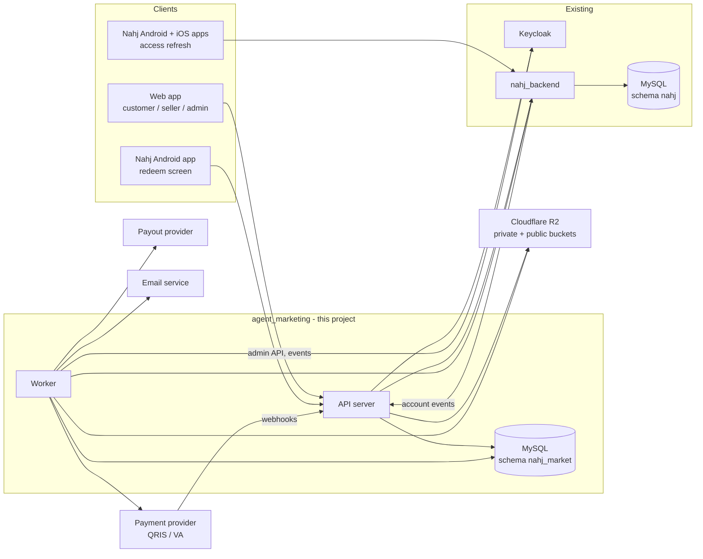
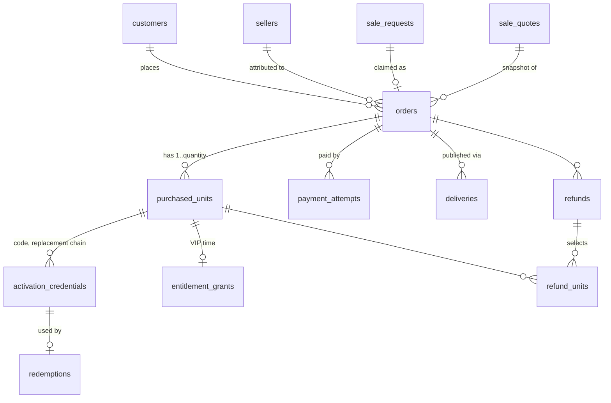
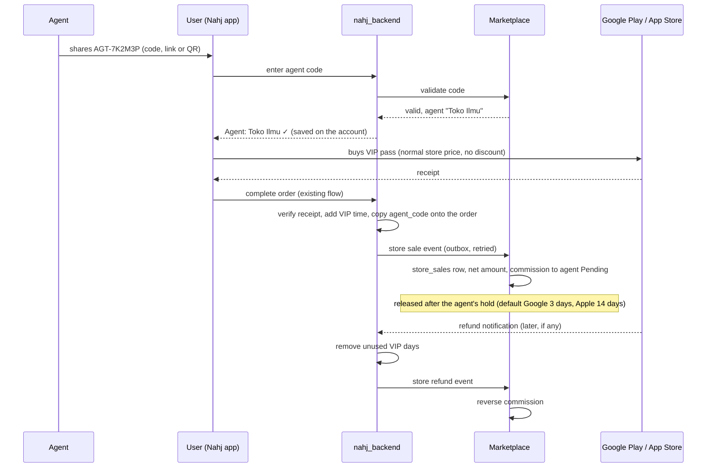

# Nahj Seller Marketplace — System Architecture

Status: draft for review, revised 2026-10-14 after the system analysis (`02-system-analysis.md`).
Scope: Indonesia V1 of the seller marketplace at `https://nahj.ryam.app`.
Sources: `Nahj_Final_Developer_Reference.md` (v2.0), `Nahj_Complete_UX_Specification.md` (v2.0), `Nahj_28_Screen_Visual_Boards.md`, and the existing `nahj_backend` code.

Items marked **[Decision]** are recommendations that still need confirmation. They are collected in section 13.

## 1. What this system is

A web platform where approved sellers sell prepaid Nahj subscriptions. Customers pay Nahj through QRIS or virtual account. A paid order becomes either a direct activation on the buyer's account or a set of activation codes. Sellers earn commission into a wallet and withdraw it. Staff handle applications, payments, refunds, payouts, risk and support.

It is a separate project from `nahj_backend`. The game backend keeps ownership of user accounts and of what a user can access in the app. This system owns everything about selling: sellers, orders, payments, codes, commissions, wallets, withdrawals, refunds, referrals, support and audit.

## 2. Architecture principles

These come directly from the developer reference and shape every component.

| Principle | Consequence |
| --- | --- |
| Backend is the only source of truth for money, access and allowed actions | The frontend never computes status, price, eligibility or timers. Every response carries the statuses, the allowed actions and the server time. |
| Every mutation is idempotent | Each command takes an idempotency key and stores its outcome. A timeout is resolved by looking up the original operation, never by sending a new one. |
| Database and providers are not one transaction | External calls go through an outbox. State changes and the intent to call a provider are committed together; a worker performs the call. |
| Money history is never edited | Balances are derived from an append-only double-entry ledger. Corrections are new compensating entries. |
| Authorization is by capability and relationship | Checked on the server for every API, export and file, on every request. Hiding a button is not authorization. |
| Fulfillment is instant and automatic | At payment acceptance the system activates the direct unit or publishes the codes itself (decision 17). Retries and recovery use the same unit-level command. |
| Sensitive exceptions need a second person | Manual adjustments, large withdrawals, admin grants and configuration changes go through one approval mechanism. |

## 3. System context



Key boundaries:

- The marketplace never reads or writes the game schema, including `users`. It calls `nahj_backend` through an internal API (section 8).
- The mobile apps keep reading access state from `nahj_backend`. Only the Android redeem screen calls the marketplace API.
- Both systems trust the same Keycloak realm (`nahj`), so one Nahj account ID is used everywhere.

## 4. Components

### 4.1 Web frontend

One single-page application with three shells (customer, seller, admin) and shared components. **[Decision]** React with TypeScript and Vite.

- Served as static files from the same origin as the API, so session cookies are host-scoped and no cross-origin setup is needed.
- Screen structure follows the 28 Boards; behaviour, states and copy follow the UX specification. **[Decision]**
- Seller shell is mobile-first. Admin shell is desktop-first.
- Public pages that are shared as links (seller profile, sale request) need link-preview metadata. The API server returns a small HTML head for those routes when the request comes from a crawler; opening a sale-request link never claims the request. QR codes for sale-request links are drawn on the client.
- Countdowns use the `serverTime` returned with each response, never the device clock alone.
- All text goes through a translation layer from the start, even if V1 ships in one language.

### 4.2 API server

Go service exposing `/api/v1`. Same language and main libraries as `nahj_backend` (Gin, sqlx, MySQL) so the team can move between projects. Internally it differs from `nahj_backend` in three ways, each required by the spec:

- **Dependencies are passed in explicitly**, not held as package globals. The acceptance tests (T01–T25) are about races, replays and provider failures; they need a fake provider and a real database in tests.
- **Authentication, authorization, idempotency, rate limiting and audit are middleware**, not repeated in each handler.
- **Each use case is one transaction boundary** with explicit row locks.

### 4.3 Worker

The same codebase started in worker mode. It runs:

- The outbox dispatcher (provider calls, emails, push hints, calls to `nahj_backend`, Keycloak admin calls).
- The scheduled jobs in section 9.

Jobs and outbox rows live in MySQL and are claimed with `SELECT … FOR UPDATE SKIP LOCKED`, so several worker instances can run safely. Each run is recorded in `job_runs`. No message broker in V1.

### 4.4 Database

MySQL 8 on the existing Cloud SQL server, in its **own schema `nahj_market`** with its own database user that has no rights on the game schema `nahj`. Reasons:

- Name clashes: the game schema already has `orders`, `items` and `user_subscription`.
- Safety: a marketplace bug or leaked credential cannot change game data.
- Backup, restore and export of money data are independent of the game.
- Each project owns its migration history.
- Same server, so no extra cost; the schema can move to its own instance later without code changes.

`script/db.sql` is a reference dump of the game schema. On the game side the only schema change is new columns on `orders`, owned and migrated by `nahj_backend`.

### 4.5 Supporting services (all existing)

| Service | Use |
| --- | --- |
| Keycloak | Sign in for customers, sellers and staff; TOTP for MFA. Admin API for session logout and MFA status; user events for security holds. |
| Cloudflare R2 | **Private bucket** for seller evidence, support attachments, dispute evidence and exports; downloads use short-lived signed URLs issued after an authorization check. **Public bucket** behind a CDN path for approved seller logos and link-preview images only. |
| Email service | Transactional email and digests. |
| FCM | Push hints, sent through `nahj_backend`, which owns device tokens. |

## 5. Backend modules

One Go module, one package per domain under `internal/`. A package exposes commands and queries; only it touches its own tables.

| Module | Owns |
| --- | --- |
| `identity` | Sessions, bearer-token verification, account lookup, staff, staff invitations, capabilities, MFA step-up, security events, rate limits. |
| `catalog` | Versioned plans (each references a `nahj_backend` VIP `itemId` and snapshots its days and `is_lifetime`), IDR prices, commission rates, referral rules, market settings. Draft, scheduled and published versions; never edits a published one. |
| `content` | Policy versions and acceptances, help articles. |
| `seller` | Applications and evidence, onboarding, public profile revisions, operating status (active, paused, suspended), directory. |
| `risk` | Risk cases and scoped holds (new sales, directory, commission release, withdrawal, unit, payment). |
| `approval` | Approval requests with initiator and independent approver; frozen payloads. |
| `sales` | Sale requests and their events, quotes, orders and their frozen economic snapshot, replacement orders. |
| `payment` | Payment attempts, provider adapter, webhook intake, reconciliation, duplicate and mismatch cases, receipts. |
| `fulfillment` | Purchased units, activation credentials, delivery and publication, replacement, redeem, direct-to-code conversion. |
| `entitlement` | Client for the `nahj_backend` grant API; local record of each grant call and its state. |
| `ledger` | Accounts, journals and postings, balances, commission accrual, maturity, debt. |
| `wallet` | Withdrawal requests, fee quotes, payout destinations and their verification, payout provider adapter. |
| `refund` | Refund requests, review, unit reservation, provider refund command, disputes, evidence and chargebacks. |
| `referral` | Referral tree, period snapshots, provisional and qualified rewards, corrections. |
| `support` | Cases, messages, internal notes, attachments, routing between seller and Nahj. |
| `notify` | Durable notification records per event, recipient and channel; read state, preferences, digests, delivery and retry. |
| `reporting` | Seller and admin dashboard summaries, seller customer references, exports. |
| `audit` | Append-only log of who did what, with reason and outcome. |
| `ops` | Outbox, job scheduler, job runs, incidents, operation lookup, recovery queues. |

Dependency direction: `sales`, `payment`, `fulfillment`, `refund`, `wallet` and `referral` may call `ledger`, `catalog`, `risk`, `approval`, `notify` and `audit`. `ledger`, `risk`, `approval` and `audit` call nothing above them. `reporting` reads from other modules' query interfaces and never writes to them.

### Suggested layout

```
agent_marketing/
  backend/
    cmd/server/          main: api | worker | migrate
    internal/<module>/   one package per row above
    internal/platform/   db, config, logging, http middleware, crypto, clock
    migrations/          versioned SQL for schema nahj_market
    locales/
  web/
    src/shells/          customer, seller, admin
    src/features/
    src/shared/
  docs/
```

## 6. Data design

### 6.1 Main tables by module

| Module | Tables |
| --- | --- |
| identity | `sessions`, `staff`, `staff_capabilities`, `staff_invitations`, `security_events`, `rate_limits`, `operations` (idempotency key → outcome) |
| catalog | `config_versions`, `plans`, `plan_prices`, `commission_rates`, `seller_rate_overrides`, `referral_rules`, `market_settings` |
| content | `policy_versions`, `policy_acceptances`, `help_articles` |
| seller | `agent_codes`, `seller_applications`, `application_revisions`, `application_evidence`, `sellers`, `seller_onboarding`, `seller_profiles`, `seller_profile_revisions`, `reserved_names` |
| risk | `risk_cases`, `holds` |
| approval | `approval_requests` |
| sales | `customers`, `store_sales`, `sale_requests`, `sale_request_events`, `sale_quotes`, `orders` |
| payment | `payment_providers`, `payment_routes`, `payment_attempts`, `provider_events`, `payment_cases` |
| fulfillment | `purchased_units`, `activation_credentials`, `deliveries`, `share_events`, `redemptions` |
| entitlement | `entitlement_grants` (local record of calls to `nahj_backend`) |
| ledger | `ledger_accounts`, `journals`, `postings`, `commissions` |
| wallet | `payout_providers`, `payout_routes`, `payout_destinations`, `withdrawal_fee_quotes`, `withdrawals`, `payouts` (one row per transfer: seller withdrawal or refund payout) |
| refund | `refunds`, `refund_units`, `disputes`, `dispute_evidence` |
| referral | `referral_links`, `referral_periods`, `referral_awards` |
| support | `cases`, `case_messages`, `case_attachments` |
| notify | `notifications`, `notification_preferences` |
| reporting | `seller_daily_sales`, `seller_customer_refs`, `exports` |
| audit | `audit_events` |
| ops | `outbox`, `jobs`, `job_runs`, `incidents` |

Main column decisions:

- `orders.replaces_order_id` links a replacement order to the order it replaces.
- `sale_requests.claimed_by_account_id` and `claimed_at` record the single claim.
- `holds(scope, subject_type, subject_id, risk_case_id, placed_by, reason, released_at)` with scope one of `new_sales`, `directory`, `commission_release`, `withdrawal`, `unit`, `payment`.
- `approval_requests(type, subject_type, subject_id, payload, payload_version, initiator, approver, status, reason)`.
- `sellers.onboarding_status`; portal access requires `active`.
- `purchased_units.reversible_amount` and `reversible_commission` for overlap-safe reversals.
- `notifications.read_at` and `category`.
- `payout_destinations.verification_status`, `provider_ref`, `name_match`, `is_default`.

### 6.2 Constraints that enforce the business rules

| Rule | Enforced by |
| --- | --- |
| One sale request is claimed by at most one buyer | Single claim columns set under a row lock |
| One active order per sale request; replacements are explicit | Unique key on `(orders.sale_request_id, active_flag)` where only the active order carries the flag; `replaces_order_id` set on the new order |
| One winning payment per order | Unique key on `orders.winning_attempt_id`, set inside a locked transaction |
| One provider transaction is processed once | Unique key on `(provider, provider_transaction_id)` and on `provider_events.event_id` |
| Exactly the ordered number of units | Unique key on `(order_id, unit_index)` |
| At most one live code per unused unit | Unique key on `(unit_id, live_flag)` where only live rows carry the flag |
| One grant per source | Unique `client_order_id` on `nahj_backend.orders` (the unit or source ID), and a unique source key in `entitlement_grants` |
| A command runs once | Unique key on `operations.idempotency_key` |
| Ledger entries are created once per business event | Unique key on `(journal_type, source_id)` |
| The same loss is never reversed twice | `purchased_units.reversible_amount` locked and reduced in the reversal transaction |
| Approver is not the initiator | Check in the approval command and a database check constraint |
| Display names are unique | Unique key on the normalized display name; reserved-name list |
| Stale edits are rejected | `version` column checked on update |

### 6.3 Conventions

- **Money**: integer rupiah in `BIGINT`. No floating point. Commission is allocated per unit with a deterministic rounding rule, and the per-unit amounts are stored so reversals use the original values.
- **Time**: UTC in the database. Asia/Jakarta is applied only for seller reports, dashboards and referral months. Provider settlement time and backend confirmation time are separate columns.
- **Snapshots**: an order stores its accepted quote, plan version, unit price, total, commission rate, referral rate and referrer, and accepted policy versions. Later configuration changes never touch it.
- **Status**: payment, fulfillment and refund status are separate columns on an order, not one combined state.
- **Personal data**: the marketplace stores the Nahj account ID and, where the UX needs it, a masked email. On account deletion it anonymizes customer references and support content and keeps financial records under a pseudonymous ID.

### 6.4 Ledger

Standard double entry; every journal balances. Full design and rationale: `02-system-analysis.md` section 5.

**Seller accounts** (liabilities, one set per seller): `pending`, `held`, `available`, `locked`. A negative `available` is the seller's debt. **Withdrawn**, **Lifetime Net Earnings** and **Referral Earnings** are reports summed from journals, not accounts.

**Platform accounts** (per market): `provider_clearing`, `payout_funding` (assets); `sales_revenue`, `payout_fee_income` (revenue); `customer_suspense`, `refunds_payable` (liabilities); `commission_expense`, `referral_expense`, `adjustments` (expenses).

| Journal type | Debit | Credit |
| --- | --- | --- |
| `payment_accepted` | provider_clearing | sales_revenue |
| `payment_surplus` | provider_clearing | customer_suspense |
| `commission_accrued` | commission_expense | seller pending |
| `commission_matured` (168 h after settlement; for a code unit also after redemption or the end of its unused-refund period) | seller pending | seller available |
| `hold_placed` / `hold_released` | pending or available / held | held / pending or available |
| `referral_awarded` / `referral_reversed` | referral_expense / referrer bucket | referrer pending / referral_expense |
| `withdrawal_locked` | seller available | seller locked |
| `withdrawal_unlocked` (once) | seller locked | seller available |
| `withdrawal_paid` | seller locked (gross) | payout_funding (net), payout_fee_income (fee) |
| `withdrawal_returned` | payout_funding, fee if returned | seller available |
| `refund_approved` / `refund_completed` / `refund_cancelled` | sales_revenue / refunds_payable / refunds_payable | refunds_payable / provider_clearing / sales_revenue |
| `surplus_refunded` / `surplus_recognized` | customer_suspense | provider_clearing / sales_revenue |
| `commission_reversed` | seller pending or available | commission_expense |
| `chargeback_lost` / `chargeback_won` | sales_revenue / provider_clearing | provider_clearing / sales_revenue |
| `manual_adjustment` (after independent approval) | adjustments or seller account | the other side |

Rules:

- A Processing payout stays in `locked`. Nothing is posted until the transfer is verified, and an unknown outcome posts nothing.
- Debt is covered automatically by the next release into `available`. Pending never offsets debt early.
- A reversal debits the bucket where the original amount currently sits.
- Balances are cached per account and updated in the same transaction as the journal. A daily job re-sums postings and raises an incident on any difference.

### 6.5 Activation codes

- Generated from a cryptographic random source, long enough to be unguessable.
- Stored as a keyed hash for lookup and, separately, as an encrypted value so an authorized buyer or seller can see it again.
- Never written to logs, URLs or audit records. Shown masked by default; each reveal is audited.
- The code format (prefix, length, grouping) is a single configuration value. **[Decision]**

### 6.6 Exports

- Requested exports are rows in `exports` (requester, scope, filters, status Preparing / Ready / Expired / Failed, file key, expiry).
- A job generates the CSV, with formula neutralization, into the private bucket. The download re-checks authorization.
- Files expire after a configured period (default 24 hours) and are purged by a job.
- A code export is a fulfillment action: it publishes the exported codes to the buyer portal (D08) and is audited per code.

### 6.7 Buyers and bulk purchases

A bulk buyer is not a separate kind of user. It is any customer whose order has quantity > 1, which always means codes. A parent, a school or a company uses the same Nahj account and the same tables. V1 has no organization accounts and no child roster (the spec forbids exposing recipients).



| Table | Key columns | Notes |
| --- | --- | --- |
| `customers` | `account_id` (Keycloak `sub`, PK), `display_name`, `email_masked`, `status`, `risk_flag`, `first_order_at`, `last_order_at` | Marketplace-side profile, created on first sign-in. Not an identity store: Keycloak and `nahj_backend` stay the source. |
| `orders` | `id`, `reference`, `buyer_account_id`, `seller_id`, `sale_request_id`, `quote_id`, `plan_version_id`, `item_id`, `duration_days`, `is_lifetime`, `quantity`, `unit_price`, `total`, `currency`, `fulfillment_mode` (`direct`, `codes`), `payment_status`, `fulfillment_status`, `refund_status`, `payment_confirmed_at`, `fulfillment_due_at`, `refund_window_hours`, `unused_refund_days`, `accepted_policy_versions`, `replaces_order_id`, `version` | `fulfillment_mode = direct` requires `quantity = 1`. |
| `purchased_units` | `id`, `order_id`, `unit_index`, `unit_price`, `commission_amount`, `referral_amount`, `reversible_amount`, `status` (`awaiting_fulfillment`, `issued`, `redeemed`, `activated`, `reserved`, `refunded`, `voided`), `activated_account_id`, `activated_at`, `refund_deadline_at` | Unique `(order_id, unit_index)`. `refund_deadline_at` is payment + unused-code period while unused, and activation + 48 h once used. |
| `activation_credentials` | `id`, `unit_id`, `code_hash`, `code_encrypted`, `status` (`live`, `consumed`, `voided`), `replaces_credential_id`, `published_at`, `revealed_count` | At most one `live` credential per unit. |
| `redemptions` | `id`, `credential_id`, `account_id`, `operation_key`, `result`, `created_at` | Unique per credential. A same-account retry returns the stored result. |
| `entitlement_grants` | `unit_id`, `account_id`, `client_order_id`, `status`, `vip_start`, `vip_end`, `refunded_days` | Local mirror of the order created in `nahj_backend`. |
| `deliveries` | `id`, `order_id`, `unit_ids`, `channel` (`portal`, `email`, `copy`, `share`, `export`), `actor`, `status`, `created_at` | Portal publication is the delivery; email is a separate status. |
| `refunds`, `refund_units` | refund amount, reason, status, provider command; selected units and the amount per unit | A bulk refund selects only units that are still refundable. |

**Bulk refund rule (confirmed 2026-10-21):** a bulk buyer can refund the units whose codes were never redeemed. Redeemed units follow the 48-hour rule from their own activation. Example: 10 codes, 4 redeemed more than 48 hours ago, 6 unused → the 6 can be refunded, at their original unit price and commission (T12).

### 6.8 Multiple payment and payout providers

V1 starts with **Midtrans and Xendit**, and more providers can be added later. A new provider is one new adapter package plus configuration rows. No change to orders, ledger, fulfillment or refunds.

#### Adapters

Each provider is a Go package under `internal/payment/providers/<name>` (and `internal/wallet/providers/<name>` for payouts) that implements fixed interfaces. The rest of the system only sees these interfaces.

```go
// Money in.
type PaymentProvider interface {
    Code() string                                   // "midtrans", "xendit", "fake"
    Methods() []Method                              // qris, va_bca, va_bni, gopay, ...
    CreateAttempt(ctx, AttemptRequest) (AttemptResult, error)   // QR string, VA number, expiry
    QueryAttempt(ctx, providerRef string) (ProviderStatus, error)
    ParseWebhook(ctx, headers, body []byte) ([]ProviderEvent, error) // verifies signature first
    Refund(ctx, RefundRequest) (RefundResult, error)    // ErrRefundNotSupported → payout fallback
    QueryRefund(ctx, providerRefundRef string) (ProviderStatus, error)
    Capabilities(method Method) Capabilities         // refund? partial? refund window? min/max
}

// Money out: seller withdrawals and refund payouts.
type PayoutProvider interface {
    Code() string
    VerifyDestination(ctx, Destination) (VerifyResult, error)  // account-name check
    Submit(ctx, PayoutRequest) (PayoutResult, error)           // idempotent on our payout ID
    Query(ctx, providerRef string) (ProviderStatus, error)
    ParseWebhook(ctx, headers, body []byte) ([]ProviderEvent, error)
}
```

Rules every adapter follows:

- It maps the provider's statuses to our fixed set (`pending`, `succeeded`, `failed`, `expired`, `unknown`). It never decides business outcomes; the payment module does.
- It sends our attempt, refund or payout ID as the provider's idempotency key or reference, so a retry never creates a second charge or transfer.
- It returns the provider's settlement time when the provider reports one. Commission maturity is counted from that time.
- It stores the raw webhook body in `provider_events` before anything else happens.
- A `fake` provider implements both interfaces for local development and the acceptance tests.

#### Configuration (data, not code)

| Table | Purpose |
| --- | --- |
| `payment_providers` | Code, display name, enabled, environment (sandbox or production), credentials reference in the secret store (never the secret itself), webhook secret reference. |
| `payment_routes` | Which provider handles which method: `method`, `provider`, `priority`, `enabled`, `min_amount`, `max_amount`, `fee_fixed`, `fee_percent`, `vat_included`. Versioned like the rest of the catalog. |
| `payout_providers` | Same as `payment_providers`, for money out. |
| `payout_routes` | Destination type (bank, e-wallet) → provider, priority, fee, limits. |

Example route set for launch:

| Method | Provider | Priority |
| --- | --- | --- |
| `qris` | xendit | 1 |
| `qris` | midtrans | 2 |
| `va_bca`, `va_bni`, `va_bri`, `va_mandiri`, `va_permata` | xendit | 1 |
| `gopay` | midtrans | 1 |
| payouts to banks and e-wallets | xendit | 1 |

#### How routing works

1. **Checkout.** The buyer sees the **methods** (QRIS, BCA VA, GoPay…), not the providers. The server lists every method with an enabled route whose amount limits fit the order.
2. **Creating an attempt.** The server picks the enabled route with the highest priority for that method and stores `provider` and `route_version` on the `payment_attempts` row.
3. **Failover.** If the provider is down when the attempt is created, the server tries the next route for the same method. This is safe because nothing was charged yet. An attempt already created is never moved to another provider.
4. **Everything after creation stays with the original provider.** Webhooks, reconciliation and refunds of an attempt always go to the provider that created it, even if the routes change later.
5. **Turning a provider off.** Disabling its routes stops new attempts. Existing attempts, refunds and reconciliation continue until they are finished.

#### Webhooks

- One endpoint per provider: `/api/v1/webhooks/{provider}` and `/api/v1/webhooks/payout/{provider}`.
- The adapter verifies the signature, and the server checks the merchant, amount and currency against the stored attempt (§10.1).
- Uniqueness is per provider: `(provider, event_id)` and `(provider, provider_transaction_id)`.

#### Refunds across providers

1. Ask the original provider's adapter whether the method supports this refund (full or partial, inside the provider's refund window).
2. If yes: call `Refund` on that provider.
3. If not, which is always the case for bank VAs and for some QRIS cases: **refund by payout**. The buyer gives a bank or e-wallet account, the payout route verifies it, and a payout is sent through the payout provider. The refund record keeps `refund_method` (`provider` or `payout`).

#### Ledger and reconciliation

- `provider_clearing` and `payout_funding` are kept **per provider** (for example `provider_clearing:xendit`, `provider_clearing:midtrans`). Each provider's daily report is reconciled against its own account.
- Fees are recorded per attempt from the route, then corrected to the provider's actual fee during reconciliation.

#### Adding a provider later

1. Write the adapter package and its tests against the provider's sandbox.
2. Add the provider row and its secrets.
3. Add routes with low priority or disabled, and test in staging.
4. Raise the priority or enable the routes in the admin catalog. No deployment of other modules is needed.

### 6.9 App-store sales through agent codes (flow B)

A second sales channel, added on 2026-10-25 and not in the original specification. The user buys VIP **inside the Nahj app** through Google Play or the App Store. An agent code the user entered earlier credits the agent. Google and Apple collect the money, so no payment gateway is involved.

#### Flow



#### Rules (confirmed 2026-10-25)

| Rule | Value |
| --- | --- |
| Agent code | One permanent code per agent: `AGT-` + 6 characters from an alphabet without 0/O and 1/I/L (about 729 million codes). An optional custom alias (for example `TOKOILMU`) must be unique and approved by staff. The dashboard shows the code, a share link (`nahj.ryam.app/a/AGT7K2M3P`) and a QR code. |
| Linking | The user enters the code in the app, or opens the link. `nahj_backend` validates it with the marketplace and saves it on the user's account (`users_attributes`). The app pre-fills it for later purchases; the user can change or remove it. |
| Attribution | At purchase completion, `nahj_backend` copies the saved code onto that order. Later code changes never move a past sale to another agent. |
| Price | The user pays the normal store price. **No discount** (UX C04: "no coupon input or discounts invented"). |
| Commission base | **Net**: the price without VAT, minus the store fee. `net = price × 10000 / (10000 + vat_bps) × (10000 − store_fee_bps) / 10000`, in whole rupiah, rounded down. VAT and store fee rates are market settings per store. Finance reconciles the estimate against the stores' monthly reports. |
| Commission | `net × agent rate`. Employee agents have rate 0. |
| Currencies that earn | Configurable list, starting with `IDR`. Sales in other currencies are recorded but earn nothing. |
| Hold before release | Default per store: Google **3 days**, Apple **14 days**, as market settings. **Each agent's wallet can override them.** The values are copied onto the store sale when it is recorded. |
| Refund after release | Commission is reversed. Available may go negative, and future earnings cover it, as with web sales. |
| Self-purchase | Allowed, as for web sales. |
| Referral rewards | Store sales count toward the referred agent's monthly target in the same way as web sales, using net amounts. |

#### Agent types

| | Partner | Employee |
| --- | --- | --- |
| Commission | Default rate or personal override | Always 0 |
| Referral rewards | Yes | No |
| Wallet and withdrawals | Yes | Hidden |
| Sales tracking, dashboard, agent code, sale links | Yes | Yes |
| Verification documents | Required | Not required |
| Public directory | Listed | Hidden by default, with a switch |

Journals with a zero amount are not posted. The sale and its attribution are still recorded for reporting.

#### Integration

| Direction | Endpoint |
| --- | --- |
| nahj_backend → marketplace | `GET /internal/v1/agent-codes/{code}` → `{valid, agentId, displayName, agentType}` |
| nahj_backend → marketplace | `POST /internal/v1/store-sales`: `{store, storeTransactionId, originalTransactionId, userId, itemId, priceAmount, currency, purchasedAt, agentCode}`. Idempotent on `(store, storeTransactionId)`. |
| nahj_backend → marketplace | `POST /internal/v1/store-sales/{store}/{storeTransactionId}/refund`: `{refundedAt, reason}`. Idempotent. |

`nahj_backend` authenticates with its own Keycloak service client (`nahj-backend-service`). It sends these events through a local outbox table with retries, so no event is lost when the marketplace is down.

## 7. Identity and security

### 7.1 Sign in

| Client | Mechanism |
| --- | --- |
| Web | The API server runs the OpenID Connect login with Keycloak and issues its own secure, HTTP-only, same-site session cookie. Tokens never reach browser JavaScript. Mutations require a CSRF token. |
| Android redeem | The app sends its existing Keycloak bearer token. The same endpoints accept either a session cookie or a bearer token. Access tokens are short-lived in the realm. |
| Payment and payout webhooks | No user session. Authenticated by provider signature and source checks. |
| `nahj_backend` callbacks | Service credential on an internal endpoint. |

Guest (anonymous) app accounts are rejected for purchase and redeem.

### 7.2 Roles and capabilities

Keycloak answers "who is this". The marketplace database answers "what may they do". **[Decision]**

- A seller is an account with an approved `sellers` row **and** completed onboarding: MFA set up, current seller terms accepted, display name approved. Until then the seller sees only the onboarding checklist.
- A staff member is an account with a `staff` row and a set of capabilities, each scoped to a market. Staff are added by invitation; the last active Super Admin cannot be disabled.
- Capabilities and seller status are read on every request, so disabling staff or suspending a seller takes effect immediately in this system.
- Each API route declares the capability it needs. Each query is also filtered by relationship: a seller sees only orders attributed to them, a customer only their own.
- Actions needing independent approval go through `approval_requests`, which rejects approval by the initiator.

### 7.3 MFA

- Staff sign in always requires TOTP, enforced in Keycloak.
- Sensitive seller actions (withdrawal, payout destination change) require a fresh step-up challenge. **[Decision]** Use Keycloak re-authentication with TOTP and check the authentication time on the server.
- No SMS.

### 7.4 Sessions and security events

- Disabling staff, suspending a seller or the user choosing "sign out other devices" deletes local sessions and calls the Keycloak admin API to log out the user's Keycloak sessions.
- Keycloak user events are enabled for password reset, credential update and TOTP changes. The worker polls the Keycloak admin events API and stores them in `security_events`. Configured events place a time-limited `withdrawal` hold.
- A payout destination change notifies the previous verified email and places the same hold.
- Account, seller and staff screens list security events and active sessions from these sources.

### 7.5 Other controls

- Rate limiting with MySQL-backed fixed-window counters keyed by account, IP, email or code prefix. Covers redeem, sign-in challenges, resend cooldowns and recovery requests. Responses return the retry time.
- Upload type and size limits and malware scanning before a file becomes downloadable.
- Lookups of customers by email record a purpose in audit.
- Secrets come from environment or a secret store, never from a config file in the repository.
- Audit records store redacted before and after values; never passwords, one-time codes, tokens, full bank numbers or raw activation codes.

## 8. Integration with nahj_backend

### 8.1 Endpoints

New internal endpoints in `nahj_backend`, reachable only from the marketplace and protected by a service credential:

| Endpoint | Purpose |
| --- | --- |
| Get account | Confirm the account exists and is not a guest (`user_type` 0); return display name and masked email (email comes from Keycloak). |
| Find account by email | Admin customer lookup. Returns the account ID only. |
| Get VIP items | Existing `GET /v1/shop/products?category=vip_pass`, called with the marketplace's Keycloak service-account token. Used when Super Admin publishes a plan version. |
| Create grant | Complete an order for one source through the existing order flow: account, `itemId`, snapshotted days, `is_lifetime`, `source` and `client_order_id`. Rejects a mismatch with the item. Idempotent on `client_order_id`; a repeat returns the original result. |
| Refund grant | Mark one order refunded after a refund or chargeback and subtract its days under the refund rule (§8.2). Idempotent. |
| List grants | All VIP orders of an account across sources (store, marketplace, admin), for "My Subscription" history and Support. |
| Get access projection | Account ID, projection version, coverage, active flag, expiry or Lifetime marker, evaluation time. Used for redeem preview and for "My Subscription". |
| Send notification | Deliver an in-app or push hint to the account's devices. |

And one call in the other direction:

| Callback to the marketplace | Purpose |
| --- | --- |
| Account deleted | The marketplace anonymizes the account's customer references and support content. |

The marketplace treats `nahj_backend` as an external provider: calls go through the outbox, and an unknown result is resolved by repeating the same idempotent call.

### 8.2 Grants and the access projection in `nahj_backend`

Today access is one `user_subscription` row per pass plus `users.user_type`. Store VIP products are one-time passes (`durationInDays`), not auto-renewing subscriptions. The analysis (section 2) lists the current behaviour and five defects.

Required changes:

- **Per-purchase records in the existing `orders` table** (confirmed): every source of VIP time is one order with `source` (`store`, `marketplace`, `admin`, `legacy`). `client_order_id` is the unique source reference; for a marketplace unit it is the unit ID. Add `duration_days`, the real VIP `start_time` and `end_time`, correct `amount` and `currency`, `refunded_at` and `refunded_days`.
- **Grant** = an internal endpoint that runs the existing initiate-and-complete logic (`OrderProcess`) in one transaction, idempotent on `client_order_id`.
- **Rules** (confirmed; analysis §2.3):
  - days × 24 hours;
  - new time starts at the end of current VIP time, or now;
  - a code's days start at redemption.
- **Refund** (confirmed): early refunds are accepted and late refunds are refused; the assumed window is 48 hours after activation (catalog setting `refund_window_hours`, snapshotted on the order); unused codes are refundable for 30 days after payment (catalog setting `unused_refund_days`); a code's commission is released only after it is redeemed or that period ends; store purchases follow Google and Apple rules. A refund or chargeback subtracts the order's unused days, `max(0, end_time − max(start_time, now))`, and moves the user's later orders earlier by the same amount. Chargebacks cannot be refused, and under this rule a late chargeback never cuts a newer purchase.
- **Lifetime** is subscription time: the one-time item `vip_pass_lifetime`, kept at 36,500 days (100 years) to avoid misleading-naming risk. It is shown with its real date, for example "Lifetime · until 20 Oct 2126". While an account has an active `is_lifetime` order, it cannot directly activate or redeem more VIP for itself, but can buy codes for others.
- **Compatibility cache**: after every change, write `user_subscription` (the computed expiry) and `users.user_type`, so the existing apps keep working.
- **No-Ads is removed** (confirmed 2026-10-21): ads were removed from the game, so No-Ads has no value. No migration is needed. Remaining No-Ads rows are left to expire, and `user_type` 2 is no longer written.
- **Defects to fix**: the expiry job never resets `user_type` for existing users; the store refund handler resets `user_type` without revoking the specific purchase and crashes when no order is found; the flows have no transactions or unique constraints.
- **The apps refresh the projection** on sign in, on resume and when a push hint arrives.

## 9. Background jobs

| Job | Trigger | Behaviour |
| --- | --- | --- |
| Outbox dispatch | Continuous | Sends queued provider calls, grant calls, Keycloak admin calls, emails and push hints. Retries with backoff. |
| Payment reconciliation | Every few minutes | Queries the provider for unresolved attempts, including locally expired ones. |
| Fulfillment recovery | Every minute | Retries units whose instant fulfillment failed (for example `nahj_backend` unreachable); alerts Operations when a paid order is not fulfilled within a configured time. |
| Commission maturity | Hourly | Releases matured, unheld commission. Code units wait for redemption or the end of their unused-refund period. Debt is covered by the release. |
| Referral month close | Start of each Jakarta month, plus on correction | Qualifies periods and posts or reverses awards. |
| Refund and payout reconciliation | Every few minutes | Queries the original provider command for unknown outcomes. Never resends blindly. |
| Payout destination verification | Every few minutes | Resolves pending verifications with the payout provider. |
| Daily money reconciliation | Daily | Compares provider records with the ledger; differences become cases. |
| Ledger balance check | Daily | Re-sums postings against cached balances; differences become incidents. |
| Risk review and dispute deadlines | Hourly | Alerts owners of overdue risk reviews and approaching provider dispute deadlines. Never releases a hold. |
| Keycloak events | Every minute | Imports security events and places configured holds. |
| Exports | Continuous / daily | Generates requested exports; purges expired files. |
| Dashboard summaries | Every few minutes | Refreshes summaries that are not updated in the source transaction. |
| Notification retry and digest | Continuous / daily | Retries delivery only, never repeating a business effect; sends digest emails. |

## 10. Key flows

### 10.1 Payment acceptance

1. A webhook arrives, or reconciliation polls the provider.
2. The server verifies authenticity, then merchant, reference, amount and currency against the stored attempt.
3. In one transaction: store the provider event; lock the order; if it has no winning attempt, set this one, set `payment_confirmed_at`, create the purchased units, post `payment_accepted` and `commission_accrued`, **fulfill at once** (§10.2), and queue notifications.
4. If the order already has a winner, post `payment_surplus` and open a duplicate-payment case. No new units, no new commission.
5. If any economic field does not match, post `payment_surplus` and open a mismatch case for Finance. No fulfillment.

### 10.2 Fulfillment

Fulfillment is **instant at payment** (decision 17, 2026-10-23). The 30-minute seller window, the seller "Deliver" and "Activate" steps, the deadline job and the deadline reminder from the specification are not built.

1. In the payment-acceptance transaction, the system calls the unit command for every unit. Holds on the order's units or payment block it; a blocked unit waits for Support or Finance.
2. Direct: queue a create-grant call with `rejectIfLifetime`; mark the unit activated when `nahj_backend` confirms.
3. Codes: generate every credential, publish all of them to the buyer's "My Purchases" at once, and queue the email (a single code in the body; a bulk order links to "My Purchases").
4. The order's fulfillment status is completed when every unit is activated (direct) or published (codes). It does not wait for codes to be redeemed.
5. Failures (for example `nahj_backend` unreachable) are retried by the recovery job with the same idempotent command. The buyer sees "Paid — activating"; Operations is alerted if it takes too long.
6. If a direct grant is refused because the buyer became a Lifetime holder after creating the order, the unit is held. With the buyer's consent, Support converts it to a code or starts a refund review.
7. The seller sees the order as paid and fulfilled, and earns the commission as before.

### 10.3 Redeem

1. Check: look up the code by hash, read the account's projection, return a preview. Nothing is reserved. A Lifetime holder gets "You already have Lifetime access" and the code stays unused.
2. Confirm: in one transaction, lock the credential and unit, re-check holds and eligibility, mark the code consumed for this account, queue the create-grant call.
3. A repeat by the same account returns the original result. Another account gets a neutral "already used" answer.

### 10.4 Withdrawal

1. The seller gets a fee quote, passes the step-up challenge, and confirms amount, fee quote and destination. A changed fee requires a new confirmation.
2. In one transaction: check withdrawal holds, lock the seller's ledger accounts, check available funds and minimum, freeze gross, fee, net and destination, post `withdrawal_locked`.
3. Every withdrawal enters the Finance queue. Above a configured threshold a second, independent approver is required. The worker submits the payout command once.
4. Verified transfer → Paid (`withdrawal_paid`). Definite failure → Rejected and `withdrawal_unlocked` once. Unknown → stays Processing until reconciliation resolves it. A later return → Returned (`withdrawal_returned`).

### 10.5 Refund

1. A request changes nothing and opens a support case.
2. On approval, the affected units are reserved against redeem and fulfillment, `refund_approved` is posted, and one refund command is queued: to the original provider if it supports this refund, otherwise as a payout to a bank or e-wallet account the buyer provides (always the case for bank VAs; §6.8).
3. On verified completion: post `refund_completed`; void unused codes or revoke the affected grants; reverse the original commission and referral allocations; requalify the referral month.
4. A surplus-payment refund posts `surplus_refunded` only. It touches no grant and no seller account.

### 10.6 Sale request and order

1. The seller creates a sale request; each change is a `sale_request_events` row.
2. The buyer opens the link, signs in and receives a quote with a validity time.
3. On confirmation the request is claimed and the order is created with the quote snapshot. A double click returns the same order.
4. If the economics must change after a payment attempt exists, a replacement order is created with `replaces_order_id`, after the buyer sees the pending-payment warning. A late success on the old order is still accepted under its own snapshot.

## 11. API shape

- Base path `/api/v1`, grouped as `/public`, `/me` (customer), `/seller`, `/admin`, `/internal` (service callbacks) and `/webhooks/{provider}`.
- Every mutating request carries an `Idempotency-Key` header. `GET /operations/{key}` returns the stored outcome.
- Resources return separate statuses, a version number, and an `allowedActions` list. Every response includes `serverTime`.
- Errors return a safe code and a reference ID; rate-limited responses include the retry time. User-facing text is translated from the code, as in `nahj_backend`.
- Lists use server-side filters and cursor pagination. The seller directory cursor carries a per-session seed for a stable rotated order.
- Bulk commands return a result per item.
- Exports are asynchronous: a request returns an export ID whose status is polled.

## 12. Deployment, testing and operations

- **Deployment**: one Docker image for the backend, run as two services (API and worker). The web build is static files served from the same host. Database migrations run as a separate step before a new version starts.
- **Environments**: local (fake payment and payout providers, local Keycloak), staging (provider sandboxes), production.
- **Testing**: integration tests run each use case against a real MySQL instance with fake providers and a controllable clock. The 25 acceptance cases in the developer reference become automated tests.
- **Observability**: structured JSON logs with a request ID and operation key; `job_runs` and `incidents` for the operations screen; metrics for unresolved payments, overdue fulfillments, outbox age and failed jobs; alerts on each recovery queue.

## 13. Decisions

| # | Decision | Status | Affects |
| --- | --- | --- | --- |
| 1 | Screen structure: 28 Boards for structure, UX specification for behaviour | Recommended | Frontend scope |
| 2 | Frontend stack: React, TypeScript, Vite, one app with three shells | Recommended | Frontend |
| 3 | Roles: capabilities in the marketplace database; Keycloak for identity and MFA only | Recommended | Backend, Keycloak setup |
| 4 | Step-up MFA for sellers: Keycloak TOTP re-authentication | Recommended | Backend, Keycloak setup |
| 5 | Payment providers: multi-provider with routing (§6.8); launch with Midtrans and Xendit | Decided 2026-10-23; contracts and quotes pending | Payment adapters, refund mechanism, settlement timestamp |
| 6 | Payout provider: same multi-provider design; Xendit recommended for payouts | Recommended; pending quotes | Wallet adapter, fees, refund payouts |
| 7 | Entitlement contract: one order per purchase in the existing order flow; days × 24 h; stack at end; codes start at redemption; refund subtracts the order's days; no new offline grace (§8.2) | Confirmed 2026-10-20 (refund removes unused days; early refunds only) | Game backend, mobile apps |
| 8 | Code and order reference formats | Open | Backend, copy |
| 9 | Languages for V1 | Open; translation layer from day one | Frontend, emails |
| 10 | Queue technology: MySQL-backed outbox and jobs; no broker in V1 | Decided | Operations |
| 11 | Database: separate schema `nahj_market` on the same server | Decided | Operations, security |
| 12 | Lifetime = the one-time 36,500-day (100-year) VIP item, shown with its date; Lifetime holders cannot add VIP to their own account; sold on web and in stores | Confirmed 2026-10-20 | Game backend, mobile apps, Terms |
| 14 | Marketplace plans reference `nahj_backend` items by `itemId`, read through the API, with IDR prices in the marketplace catalog | Decided | Catalog, entitlement |
| 15 | Web sells all five VIP items: Weekly, Monthly, 6-Month, Yearly, Lifetime | Confirmed 2026-10-18 | Catalog |
| 17 | Fulfillment is instant at payment: direct units activated and codes published automatically; no seller delivery step and no 30-minute window | Confirmed 2026-10-23 (changes the approved spec rule Dev Ref §5.1) | Fulfillment, seller screens, jobs, acceptance tests T06–T08 |
| 18 | App-store sales through agent codes (flow B, §6.9): commission on net, code saved on the user account and copied onto each order, no discount, earning currencies configurable (IDR first) | Confirmed 2026-10-25 (new channel, not in the specification) | nahj_backend, mobile apps, ledger |
| 19 | Store commission hold: defaults Google 3 days, Apple 14 days; configurable per agent wallet | Confirmed 2026-10-25 | Ledger, seller settings |
| 20 | Agent types: partner and employee (0% commission, no referral rewards, no wallet, hidden from directory by default) | Confirmed 2026-10-25 | Sellers, ledger, directory |
| 16 | Refund windows: 48 h after activation (per plan); unused codes 30 days after payment; code commission released at redemption or period end. All configurable. | Confirmed 2026-10-21 | Catalog, refund, ledger |
| 13 | Withdrawal approval: every withdrawal through Finance; second approver above a threshold | Decided (UX A11) | Wallet |

## 14. Build order

1. **Foundation**: project skeleton, migrations, identity and sessions, capabilities, idempotency, rate limits, audit, approvals, holds and risk cases, policy acceptances, outbox, jobs and job runs.
2. **Catalog and sellers**: versioned configuration, seller application, onboarding and approval, profile revisions, public marketplace.
3. **Sales and payment**: sale requests, quotes, orders and replacements, payment attempts with a fake provider, acceptance and reconciliation, receipts.
4. **Fulfillment and entitlement**: units, codes, redeem, the order-flow changes and grant endpoints in `nahj_backend`, the 30-minute job.
5. **Ledger and wallet**: accounts and journals, commission, maturity, withdrawals with a fake payout provider.
6. **Refunds and disputes.**
7. **Referrals.**
8. **Support, notifications, exports and dashboards.**
9. **Real provider integration, Keycloak events, Android redeem, launch readiness.**

Steps 1–3 need no outstanding business answers. Step 4 can start on the baseline contract; the projection rule is finalized when decision 7 is confirmed. Step 9 needs decisions 5 and 6.
